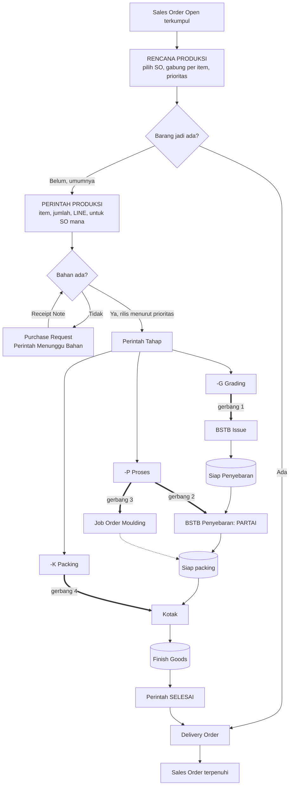

# Usulan Konsep Perintah Produksi: dari Sales Order sampai barang di-issue

> Status: **digantikan oleh `Perintah-Produksi-Plan.md` (24/11/2026).** Disimpan sebagai riwayat dan pencocokan SOP (bagian 8, 10).
> Alur utamanya mengikuti penjelasan verbal user 24/11/2026, dicocokkan dengan SOP di bagian 10.
> Dasar: `walet sop.md`, scan SOP.PPIC.01.01, SOP.MKT.04.01, SOP.PROD.02.01, SOP.LOG.02.02, dan proses yang sudah
> berjalan (`Produksi Walet (Real).md`, disingkat PWR, dan aplikasinya).
> Dua form PPIC di folder `walet/` hanya **alat bantu atau contoh pecahan harian**, bukan dasar aturan (bagian 8).
> Di luar usulan: Obi, Home Industri, JBG.
> **[SOP]** tertulis di SOP · **[Sistem]** sudah ada · **[Usulan]** saran di sini.

## 1. Masalah

Sales Order Open berhenti tanpa dokumen produksi. Sesudah itu semua dipilih bebas [Sistem]: BSTB Issue (untuk apa?),
BSTB Penyebaran (line apa dan mengapa?), Job Order (jenis untuk siapa?), Kotak (Sales Order mana?).

**Yang hilang adalah kepalanya:** rencana dan perintah yang menyatakan apa yang harus jadi, berapa, lewat line apa, mana
duluan, dan untuk Sales Order mana. Tanpa itu produksi sekadar menghasilkan stok. Form harian hanya pecahannya.

## 2. Yang dikatakan SOP

1. **Asal:** Business Plan manajemen dan Sales Order. Isi permintaan: item produk, kuantiti, jenis kemasan, tanggal kirim. [PPIC]
2. **Kesanggupan dulu:** Sales, PPIC dan Produksi sepakat tanggal dan jumlah berdasar stok bahan baku, bahan bersih, bahan
   kemas dan kapasitas, baru Sales Order terbit; lembar ketiga untuk PPIC sebagai dasar perencanaan. [MKT]
3. **PPIC cek FG.** Kurang berarti menghitung bahan baku, bahan kemas, lead time. Bahan tidak ada berarti planning pembelian. [PPIC]
4. **Planning dipecah dan diserahkan bertahap:** grading halus ke SPV Bahan Baku; produksi (penyebaran, cleaning, moulding)
   sesudah Pre Cleaning; packing ke SPV Packing. [PROD.02.01, PPIC]
5. **Tiga tempat barang menunggu**, terlihat dari jalur lead time: bahan siap Penyebaran, barang 95% siap packing, FG. [PPIC]
6. Planning adalah "acuan kerja yang **harus dicapai**"; planning vs realisasi dilaporkan harian, mingguan, bulanan. [PPIC]

SOP menyebut pemicu (butir 1) dan pecahannya (butir 4), tetapi **tidak menyebut dokumen yang menyatukannya**. Itulah yang diusulkan.

## 3. Konsep: rencana, perintah, tahap [Usulan]

Prinsip: **tidak ada produksi tanpa sesuatu yang dipenuhi.** Asalnya Sales Order; tiap turunan menunjuk yang di atasnya.

| Tingkat | Menjawab | Dibuat dari |
| --- | --- | --- |
| **1. Rencana Produksi** `RP/YYYY/MM/NNNN` | Sales Order mana yang dikerjakan, **mana duluan**, barangnya ada atau belum, bahannya ada atau belum | Sales Order terkumpul, dipilih PPIC |
| **2. Perintah Produksi** `PP/YYYY/MM/NNNN` | **Buat item apa, berapa, line apa, batas kapan, untuk Sales Order mana** | Baris Rencana |
| **3. Perintah Tahap** (Grading, Proses, Packing) | Siapa mengerjakan bagian mana, barang yang di-issue untuk mana | Perintah Produksi |

Jadwal harian adalah pecahan tingkat 3 (3.4). Ia tidak punya tujuan sendiri.

### 3.1 Rencana Produksi: guideline utama

PPIC mengumpulkan Sales Order Open, memilih baris yang mau dikerjakan, lalu sistem menampilkan dan menggabung per item:

| Kolom | Isi |
| --- | --- |
| Item (Nama Jual) dan **Line** | Line melekat pada item; PPIC memilih hanya bila item belum punya line |
| Dibutuhkan | Σ sisa Sales Order yang dipilih, tiap SO dan Tanggal Kirim terlihat |
| Sudah ada | FG yang belum dipakai Sales Order lebih awal, dan Perintah lain yang sedang berjalan |
| **Dibuat** | Dibutuhkan − sudah ada. Nol berarti langsung ke Delivery Order |
| Bahan | BB dan bahan kemas: butuh, ada, kurang |
| **Prioritas** | Urutan 1, 2, 3 … diusulkan dari batas mulai terawal, diubah PPIC |
| Keputusan | *Produksi*, *Beli bahan dulu*, atau *Tunda* (tetap di antrean, tidak hilang) |

`Draft → Ajukan → Setujui (Berlaku) → Selesai`. Saat disetujui: baris *Produksi* dan *Beli bahan dulu* melahirkan Perintah
Produksi; bahan kurang melahirkan Purchase Request yang menunjuk Perintahnya. Rencana selesai saat semua Perintahnya selesai.
Prioritas boleh diubah selama Berlaku, dengan riwayat.

### 3.2 Perintah Produksi

**Satu item, satu line, satu jumlah.** Melayani satu atau beberapa baris Sales Order, dengan bagian masing-masing (SO
terawal dulu). Memuat batas masuk FG, prioritas, kebutuhan per tahap, dan capaian.

| Status | Arti |
| --- | --- |
| Menunggu Bahan | Bahan belum cukup; Perintah Tahap belum bisa dirilis, Purchase Request berjalan |
| Siap | Bahan ada, menunggu dirilis menurut prioritas |
| Dirilis | Boleh di-issue dan dikerjakan |
| Selesai | Seluruh jumlah diterima FG |
| Ditutup Kurang | Alasan wajib; sisanya kembali ke antrean Rencana |

Bahan datang sebagian boleh merilis sebagian lewat Perintah Tahap pertama.

**Dijual:** saat selesai, Sales Order yang dilayani ditandai *Siap Kirim* dan diteruskan ke Delivery Order yang sudah ada.
Penandaan ini belum mengunci stok FG (lihat Q12).

### 3.3 Perintah Tahap

Batasnya di tiga tempat menunggu. Nomornya membawa nomor induk, sehingga di lantai tujuannya langsung terbaca.

| | **Grading** `PP/…-G1` | **Proses** `PP/…-P1` | **Packing** `PP/…-K1` |
| --- | --- | --- | --- |
| Penerima | SPV Bahan Baku | SPV Bahan Baku, lalu unit line | SPV Packing |
| Dari → sampai | Gudang → lolos QC Pre Cleaning | Penyebaran → keluar Barcoding | Packing 95 → diterima FG |
| Bahan | Jenis BB + gram **boleh di-issue** | Jenis siap Penyebaran + gram | Keping siap packing + bahan kemas |
| Target | Jenis + gram siap Penyebaran | Jenis + gram siap packing, termasuk target Job Order | Kotak |
| Terpenuhi oleh | Gram jenis target lolos QC Pre Cleaning | Gram jenis target lolos checkpoint Barcoding | Kotak diterima FG |

- Satu Perintah boleh punya beberapa perintah tahap sejenis. Tahap yang tidak perlu tidak dibuat.
- **Hasil lebih atau jenis lain** tercatat berasal dari perintah itu, menjadi stok di tempat menunggunya, dan mengurangi
  kebutuhan Perintah berikutnya. Satu pengambilan boleh menghasilkan banyak jenis tanpa merusak tujuan.

### 3.4 Urutan kerja di lantai

Tiap unit melihat pekerjaannya **urut prioritas Rencana**, lalu batas tanggal, dengan Perintah, item, line dan sisa. Mengerjakan
yang bukan teratas tetap boleh (barangnya bisa belum siap), tetapi terlihat di laporan. Jadwal harian: tanggal × workstation ×
jenis × gram, realisasi dibaca dari dokumen produksi.

## 4. Alur

### 4.1 Dari item ke kebutuhan bahan

| Langkah | Hitungan | Menjadi |
| --- | --- | --- |
| 1 | Sisa Sales Order − FG − Perintah berjalan | Jumlah Perintah Produksi |
| 2 | Kotak | Perintah Packing |
| 3 | Kotak × gram BoM − keping siap packing | Perintah Proses |
| 4 | Gram ÷ rendemen − siap Penyebaran | Perintah Grading |
| 5 | Gram ÷ rendemen − BB gudang; bahan kemas − stok | Purchase Request |

- Stok dihitung untuk Perintah berprioritas lebih tinggi dulu, sehingga tidak terpakai dua kali. Ini hitungan, bukan kuncian.
- Sales Order **Open** masuk Rencana; **Pra-SO** hanya boleh sampai rencana beli bahan (P79).
- Rendemen diisi PPIC: SOP tidak memuatnya (G-15).

### 4.2 Batas tanggal, mundur dari Tanggal Kirim (D), hari kerja [SOP PPIC]

Beli BB D−43 · Grading D−37 → D−31 · Proses D−31 → D−16 · Packing D−16 → D−12 · sesudah FG (back stiker, PSI, karantina) D−12 → D.
Yang terlewat tampil **Terlambat** sejak Planning; informasi, bukan penolakan.

### 4.3 Siklus dan kewajiban memenuhi

Status Rencana dan Perintah di 3.1 dan 3.2. Persetujuan satu kali, di Rencana.

- Perintah Produksi **Selesai** hanya bila seluruh jumlahnya diterima FG. Perintah tahap selesai tidak menyelesaikan induknya.
- **Perintah Dirilis tidak bisa dibatalkan.** Ia terpenuhi, atau Tutup Kurang dengan alasan; sisanya **kembali ke antrean Rencana**.
- Item, jumlah dan line terkunci sejak Dirilis. Perintah tahap dan jadwal boleh ditambah selama tujuan belum tercapai.
- Kekurangan satu tahap: PPIC menambah perintah tahap baru di Perintah yang sama, sehingga riwayatnya tetap satu.
- Induk tidak bisa Tutup Kurang selagi perintah tahapnya masih punya barang berjalan.
- Sales Order yang dilayani Perintah berjalan tidak bisa ditutup.

### 4.4 Empat gerbang: tanpa perintah, ditolak

| # | Dokumen | Wajib menunjuk | Yang terisi | Ditolak bila |
| --- | --- | --- | --- | --- |
| 1 | BSTB Issue *Bahan ke Produksi* | Perintah Grading | Tujuan, line, jenis BB, sisa issue | Jenis di luar daftar atau melebihi sisa |
| 2 | BSTB Penyebaran | Perintah Proses | Line, routing, jenis, sisa sebar | Jenis di luar daftar atau melebihi sisa |
| 3 | Job Order Moulding | Ikut partai | Pilihan jenis dari target | Tidak; jenis lain diberi peringatan |
| 4 | Kotak Packing 95 | Perintah Packing | Nama Jual, BoM, sisa kotak | Melebihi sisa |

Dokumen di antaranya (Grading, Pengerjaan, QC, Push, BSTB) mewarisi. Balik QC tetap di perintah yang sama. BJL, Reject dan
BSTB Pengeluaran tidak dihitung sebagai hasil.

## 5. Contoh (rendemen hanya ilustrasi)

Sales Order 10 kotak @50 g, Reguler; FG 4 kotak, keping siap packing 100 g, siap Penyebaran 150 g.

| Dokumen | Isi |
| --- | --- |
| RP/2026/11/0001 | SO dipilih, prioritas 1; dibutuhkan 10, ada 4, **dibuat 6** |
| **PP/2026/11/0001** | **6 kotak item itu, line Reguler, untuk SO …, batas FG D−12** |
| PP/2026/11/0001-K1 | 6 kotak = 300 g |
| PP/2026/11/0001-P1 | 300 − 100 = 200 g; rendemen 80% → bahan 250 g |
| PP/2026/11/0001-G1 | 250 − 150 = 100 g; rendemen 90% → BB 111,1 g |
| BSTB Issue ke `…-G1` | Paling banyak 111,1 g, dan layar menyebut tujuan, line, Sales Order dan batasnya |

Bila `-G1` hanya memberi 90 g, PPIC menambah `-G2` 10 g di Perintah yang sama. Tujuan 6 kotak tidak berubah.

## 6. Jejak dan dampak

- **Issue → tujuan satu langkah** (nomor tahap membawa nomor induk) → Sales Order. Sebaliknya satu Perintah menampilkan semua
  issue, partai, kotak dan sisanya.
- Barang sebelum partai mengenal perintahnya lewat Job dan No. Grading yang lahir dari Issue; sesudahnya lewat Partai; kotak
  lewat dokumen Kotak. **Bucket buku produksi tidak bertambah kolom.**
- Barang siap Penyebaran dari Perintah lain boleh dipakai: gerbang 2 mengganti perintah yang dilayani, silsilah No. Stok tetap.
- Tanpa jurnal, nilai atau biaya. Milik ERP › Produksi; aplikasi Produksi hanya membaca (P254).

**Keputusan lama yang berubah bila disetujui:** P216/P217 (Perintah Produksi dicabut) kembali tanpa BoM per workstation dan
tanpa costing; W15, W54 dan PWR §11 (satu Rencana Produksi sebagai acuan) menjadi Rencana → Perintah Produksi → Perintah Tahap, dan Rencana menjadi wajib; W73 (line dipilih di
BSTB Penyebaran) line datang dari Perintah. W39 tetap: pra-partai satu routing, line di Grading berasal dari tujuan induk
dan baru mengikat barang di BSTB Penyebaran.

## 7. Yang belum terjawab

| # | Hal | Saran sementara |
| --- | --- | --- |
| Q1 | **Bolehkah produksi untuk stok tanpa Sales Order** (SOP: Business Plan)? | Tidak, kecuali baris Stok yang disetujui khusus |
| Q2 | Nama Jual → jenis keping yang boleh mengisinya. BoM Packing hanya gram dan jumlah keping | PPIC memilih jenis; master menyusul |
| Q3 | Jenis BB → hasil grading, dan rendemen per tahap | PPIC mengisi |
| Q4 | Bahan penolong: SOP memakai permintaan user disetujui SPV, bukan planning | Boleh menyebut Perintah, tidak wajib |
| Q5 | Siapa menyetujui? SOP hanya menyebut SPV PPIC membuat | Satu izin Setujui |
| Q6 | Boleh selesai dengan toleransi, atau harus pas? | Kotak pas; gram tahap boleh kurang karena penentunya kotak |
| Q7 | Barang bersih tanpa moulding (25 HK); sistem hanya menerima Issue di Unit pertama | Di luar usulan (W3) |
| Q8 | S-MK belum punya line dan routing | Reguler dulu |
| Q9 | "FG memenuhi → planning packing" [SOP]: apa yang dikemas bila sudah FG? | Dibaca sebagai barang 95% |
| Q10 | SOP: jalur 31 + planning 2 = 33 HK, tetapi planning wajib 3 HK sebelum produksi | Memakai tabel lead time |
| Q12 | FG hasil Perintah dikunci untuk Sales Order-nya? Sekarang Delivery Order siapa pun bisa mengambil | Dikunci saat diterima FG; perlu keputusan karena menyentuh buku stok |
| Q13 | Satu item selalu satu line? | Ya, dengan pilihan PPIC bila ada pengecualian |
| Q14 | Rencana dibuat per apa: mingguan, atau kapan saja ada SO? | Kapan saja; antrean SO selalu terlihat |
| Q15 | Pekerjaan bukan prioritas teratas: ditolak atau peringatan? | Boleh, terlihat di laporan |
| Q11 | Apakah target per tahap (gram) diputuskan PPIC atau dihitung penuh dari tujuan? | Dihitung, PPIC boleh mengubah sebelum Rilis |

## 8. Catatan dari form PPIC (contoh saja)

FRM.PPIC.01.02 memuat plan harian gram per jenis untuk Penyebaran, Cleaning, Moulding dan Packing (sisi Akui saja yang dibaca
di sini). FRM.PPIC.01.03 memuat kebutuhan BB per bulan dengan buffer. Keduanya **tidak memuat tujuan besar**: tanpa Nama Jual,
Sales Order, line, atau batas. Yang berguna sebagai petunjuk, **belum menjadi aturan**:

| Petunjuk | Dipakai di |
| --- | --- |
| Bentuk jadwal: tanggal, jenis, plan, aktual, pencapaian, analisa, solusi | 3.4 |
| Jenis Barang punya campuran bahan (S-MK = PT-3 panjang 45%, pendek 55%) | Q3 |
| Plan Moulding = plan sebar × 0,70 | Q3 |
| "Harus tercapai 90–110%" | Q6 |
| Tanda tangan: dibuat SPV PPIC; disetujui Manager PPIC & Warehouse dan Manager Produksi; diketahui GM | Q5 |
| Kebutuhan BB = kebutuhan + buffer − stok, per bulan | 4.1 langkah 5 |
| Moulding Akui memuat L-MK yang tidak disebar minggu itu, partainya tidak disebut | Alasan jadwal harus menunjuk perintah |

## 9. Urutan bangun bila disetujui

1. Rencana Produksi (pilih SO, cek FG) + Perintah Produksi + Perintah Grading + gerbang 1: issue langsung tahu tujuannya.
2. Perintah Proses + gerbang 2 dan 3.
3. Perintah Packing + gerbang 4, capaian dari FG.
4. Hitungan bahan dan Purchase Request, prioritas di Workspace, jadwal harian, rencana vs realisasi.

Barang berjalan tanpa perintah direset atau diberi Perintah saldo awal saat gerbang dipasang.

## 10. Alur verbal user (24/11/2026) dicocokkan dengan SOP

| # | Alur verbal | SOP | Hasil |
| --- | --- | --- | --- |
| V1 | PPIC mengumpulkan Sales Order | Lembar ketiga Sales Order ke PPIC sebagai dasar perencanaan (MKT.04.01) | Cocok |
| V2 | Memilih SO mana yang dikerjakan, mana duluan | Hanya lead time; **cara memilih dan prioritas tidak diatur** | Celah, diisi Rencana Produksi |
| V3 | Cek barangnya sudah ada | Cek stok FG (PPIC.01.01) | Cocok; SOP juga mengenal barang 95% |
| V4 | Cek bahan bakunya ada | Hitung bahan baku, **bahan kemas** dan **lead time** (PPIC.01.01) | Cocok, SOP lebih luas |
| V5 | Bahan tidak ada, rencanakan beli | Planning pembelian ke Purchasing, 15 HK sebelum produksi | Cocok |
| V6 | Item apa, butuh sekian | Planning memuat perhitungan kebutuhan | Cocok |
| V7 | Item ini line apa | PPIC.01.01 tidak menyebut line; SOP produksi terpisah per line | Celah, line melekat pada item |
| V8 | Issue untuk mana | Planning grading halus diserahkan sebelum ambil bahan, tanpa dokumen saat keluar (G-01) | Celah, gerbang 1 |
| V9 | Harus dipenuhi sampai selesai | "Acuan kerja yang harus dicapai"; planning vs realisasi | Cocok, tetapi **aturan selesai tidak ada** |
| V10 | Selesai lalu dijual | FG lalu pengiriman (LOG.01.01) | Cocok; kaitan ke Sales Order tidak disebut |
| V11 | Produksi bukan sekadar menghasilkan stok | Alur **dimulai dari Business Plan**, lalu Sales Order | **Perlu divalidasi:** bolehkah produksi untuk stok tanpa Sales Order? |
| V12 | Pengecekan dilakukan sesudah SO ada | Stok dan kapasitas sudah dibahas **sebelum** SO terbit (MKT.04.01) | Keduanya: kesanggupan sebelum, Rencana sesudah |
