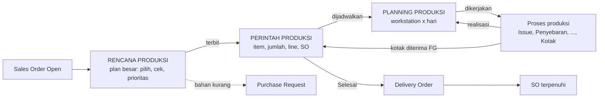

# Plan: Rencana Produksi → Perintah Produksi → Planning Produksi

> Status: **disetujui user 24/11/2026 dengan semua saran OD-1–OD-12 (P325). Belum ada yang dibangun.**
> Disimulasikan dulu di artifact, lihat `Simulasi-Rencana-Produksi-Plan.md`.
> Menggantikan `Perintah-Produksi-Concept.md` (riwayat pemikiran, pencocokan SOP dan form ada di sana).
> Dasar: penjelasan verbal user 24/11/2026, `walet sop.md`, `Produksi Walet (Real).md` (PWR). Form PPIC hanya contoh bentuk.
> Di luar plan: **produksi tanpa Sales Order (alur khusus, plan sendiri)**, Obi, Home Industri, barang bersih tanpa moulding.

## 1. Tujuan

Semua produksi punya tujuan, jadwal dan urutan: apa yang dibuat, berapa, lewat line apa, untuk Sales Order mana, mana
duluan, dan barang yang di-issue untuk mana. Produksi **memenuhi**, bukan sekadar menghasilkan stok.

## 2. Pembanding

| Sistem | Plan besar | Perintah | Jadwal | Yang dipelajari |
| --- | --- | --- | --- | --- |
| **ERPNext** | *Production Plan*: ambil item dari Sales Order, hitung bahan | *Work Order* dan *Material Request* lahir dari Plan | *Job Card* per operasi | **Bentuk paling dekat** dengan alur user: kumpulkan SO → plan → perintah + permintaan bahan |
| **SAP PP-PI** | *Planned order* dari MRP | Dikonversi menjadi *process order* (boleh sebagian), komponen menjadi reservasi, lalu *Release* | Penjadwalan kapasitas | Rencana dan perintah **dua objek berbeda**; konversi sebagian; saran praktisi: konversi **selambat mungkin**, setelah bahan dan kapasitas pasti |
| **SAP Repetitive Mfg** | Master plan | *Run schedule quantity* | ***Planning table***: material × line × periode, jumlah bisa dipecah per hari | **Padanan Excel planning PPIC**: tabel jumlah per hari, bukan dokumen per baris |
| **Business Central** | *Planned* | *Firm Planned* → *Released* → *Finished*; dibuat dari Sales Order **otomatis terhubung reservasi** | Per work center | Status mengatur apa yang boleh dilakukan; hubungan SO ↔ perintah eksplisit |
| **Odoo** | *Master Production Schedule* (peramalan) | *Manufacturing Order* | Planning per work center | MPS lebih cocok untuk alur tanpa SO |
| **Dynamics 365 SCM** | Master planning | *Batch order* dengan co-product | — | Kebutuhan boleh dipenuhi **co-product** dari batch lain; by-product dihitung dari stok nyata |
| **ERP daging / ikan** | Rencana dari stok, pembelian, penjualan | Formula pembongkaran banyak hasil | — | Hasil per grade tidak pasti; rencana hanya pendekatan. Sumber vendor, bukti lemah |

Odoo 13/17 dan SAP 4.6 adalah dokumentasi lama. Tidak ada sumber yang menjelaskan grading walet atau alokasi SO ke banyak hasil grading.

**Yang diambil:** ERPNext untuk rantainya, BC untuk status dan hubungan SO, SAP REM untuk tabel planning, D365 untuk hasil
grading yang berlebih. **Yang tidak diambil:** MRP otomatis (rendemen belum diketahui), BoM bertingkat (satu bahan menjadi
banyak jenis), backflush (bahan dikeluarkan nyata lewat BSTB Issue).

## 3. Tiga tingkat

### 3.1 Rencana Produksi `RP/YYYY/MM/NNNN` (plan besar)

1. Antrean menampilkan baris **Sales Order Open** yang belum terpenuhi. PPIC memilih yang akan dikerjakan.
2. Sistem menggabung per **item (Nama Jual)**: dibutuhkan, FG tersedia, sedang diperintahkan, **dibuat**. Cukup berarti
   langsung ke Delivery Order.
3. PPIC mengisi **line** (dari item), bahan dan rendemen; sistem menampilkan BB dan bahan kemas: butuh, ada, kurang.
4. PPIC menetapkan **prioritas** dan keputusan tiap baris: *Produksi*, *Beli bahan dulu*, *Tunda*.

Status: `Draft → Diajukan → Berlaku → Selesai`; Draft dibatalkan, Diajukan ditolak. *Tunda* dan sisa kembali ke antrean.
Disetujui berarti **Perintah Produksi terbit** untuk baris *Produksi* dan *Beli bahan dulu*, dan Purchase Request (Draft)
terbit untuk bahan kurang dengan menyebut Perintahnya. **Pra-SO** hanya boleh sampai Purchase Request (P79).

### 3.2 Perintah Produksi `PP/YYYY/MM/NNNN` (manifestasi rencana)

**Satu item, satu line, satu jumlah**, melayani satu atau beberapa baris Sales Order dengan bagian masing-masing.

| Bagian | Isi |
| --- | --- |
| Tujuan | Nama Jual, kotak, line + routing, batas masuk FG, prioritas |
| Untuk | Baris Sales Order, customer, Tanggal Kirim, bagian kotak |
| **Tahap** | **Grading** (jenis BB + gram boleh di-issue → jenis + gram siap Penyebaran); **Proses** (gram sebar → jenis + gram siap packing, target Job Order); **Packing** (kotak, bahan kemas BoM) |
| Planning | Baris jadwal milik Perintah ini |
| Capaian | Per tahap: rencana, realisasi, sisa; kotak diterima FG |

Tiga tahap mengikuti tiga planning SOP (grading halus, produksi, packing) dan tiga tempat barang menunggu (siap Penyebaran,
siap packing, FG). Tahap adalah **bagian Perintah, bukan dokumen sendiri**: satu nomor `PP` berlaku dari issue sampai FG.

Status: `Menunggu Bahan → Siap → Dirilis → Selesai`, atau `Ditutup Kurang`. **Rilis dilakukan per tahap**, selambat mungkin
dan menurut prioritas. Bahan datang sebagian boleh merilis sebagian gram.

### 3.3 Planning Produksi (jadwal, bentuk Excel PPIC)

Satu tabel: **workstation → tanggal × item/jenis → Plan · Realisasi · Pencapaian % · Analisa · Solusi**.

- Tiap sel **wajib milik satu Perintah**. Yang tampak satu baris S-MK 33.500 g boleh terdiri dari beberapa Perintah.
- PPIC memecah target tahap ke tanggal; tabel menunjukkan yang **belum dijadwalkan** dan yang melebihi target.
- Tanggal dari kalender kerja: hari libur tidak bisa diisi. Tanda merah bila melewati batas mundur (§5).
- **Terbitkan** per periode menyimpan plan dasar; pergeseran sesudahnya tercatat, sehingga pencapaian tidak bisa
  diperbaiki dengan mengubah plan. Distribusi per workstation: layar, cetak, Unduh XLSX.
- **Realisasi dibaca dari dokumen produksi**, tidak diketik. Analisa dan Solusi diketik bila meleset.

| Baris jadwal | Realisasi dari |
| --- | --- |
| Grading Halus | Gram input No. Grading UGH |
| Penyebaran | Gram BSTB Penyebaran diterima |
| Cleaning | Gram Kerja selesai |
| Moulding | Gram Job Order |
| Packing | Kotak ditutup |

Unit lain mewarisi; barisnya bisa ditambah kelak.

## 4. Dipenuhi lewat proses produksi: empat gerbang

| # | Dokumen | Wajib menunjuk | Yang terisi | Ditolak bila |
| --- | --- | --- | --- | --- |
| 1 | BSTB Issue *Bahan ke Produksi* | PP, tahap Grading Dirilis | Item, line, SO, jenis BB, sisa | Jenis di luar daftar atau melebihi sisa |
| 2 | BSTB Penyebaran | PP, tahap Proses Dirilis | **Line dan routing**, sisa sebar | Jenis di luar daftar atau melebihi sisa |
| 3 | Job Order Moulding | Ikut partai | Jenis target | Tidak; jenis lain diberi peringatan |
| 4 | Kotak Packing 95 | PP, tahap Packing Dirilis | Nama Jual, BoM, sisa kotak | Melebihi sisa |

- Dokumen di antaranya mewarisi. Jejak: sebelum partai lewat Job dan No. Grading, sesudahnya lewat Partai, kotak lewat Kotak.
  **Bucket buku produksi tidak bertambah kolom.** Balik QC tetap di Perintah yang sama; BJL dan Reject bukan hasil.
- Workspace Unit: barang **urut prioritas**, dengan PP, item, line, batas. Bukan teratas boleh dikerjakan, tercatat di laporan.
- **Hasil lebih** menjadi stok di tempat menunggunya dan mengurangi kebutuhan Perintah berikutnya. Bila barang PP-A dipakai
  PP-B, kebutuhan PP-A **dihitung ulang dan tampil kurang**: tambah gram, atau Ditutup Kurang.

**Selesai:** kotak diterima FG = jumlah Perintah. **Ditutup Kurang:** alasan wajib, tanpa barang berjalan, sisa kembali ke
antrean. Perintah Dirilis tidak bisa dibatalkan; Sales Order yang dilayaninya tidak bisa ditutup.

## 5. Hitungan

| Langkah | Hitungan |
| --- | --- |
| Dibuat | Sisa SO − FG bebas − Perintah berjalan |
| Siap packing | Kotak × gram BoM − keping bebas |
| Siap Penyebaran | Gram ÷ rendemen proses − bahan siap sebar bebas |
| BB | Gram ÷ rendemen grading − BB gudang bebas |
| Bahan kemas | Kotak × BoM − stok bebas |

*Bebas* = stok dikurangi kebutuhan Perintah berprioritas lebih tinggi. Ini hitungan, bukan kuncian. Rendemen diisi PPIC
karena SOP tidak memuatnya (G-15).

Batas mundur dari Tanggal Kirim D, hari kerja [SOP PPIC]: Beli BB D−43 · Grading D−37 → D−31 · Proses D−31 → D−16 ·
Packing D−16 → D−12 · sesudah FG D−12 → D. Yang lewat tampil Terlambat, tidak ditolak.

## 6. Data dan menu

| Tabel (bagian ERP) | Isi |
| --- | --- |
| `prd_plan`, `prd_plan_line` | Rencana; baris per item: dibutuhkan, tersedia, dibuat, line, prioritas, keputusan |
| `prd_plan_demand` | Baris SO yang dipilih (id lemah) dan bagiannya |
| `prd_order`, `prd_order_demand` | Perintah; baris SO yang dilayani |
| `prd_order_stage`, `prd_order_stage_item` | Tahap dan status rilis; bahan dan target per jenis |
| `prd_order_schedule` | Perintah, workstation, tanggal, jenis, plan dasar, plan kini, analisa, solusi |
| `sys_holiday` | Kalender hari libur |

Kolom baru: `order_no` pada Stock Issue, Job, info No. Stok turunan, BSTB Penyebaran, Partai dan Kotak; line pada Item.
Tabel milik ERP; Produksi membaca Perintah lewat fungsi modul dan menyimpan **nomornya** (P317, P318). Tanpa jurnal.

| Menu | Aplikasi |
| --- | --- |
| Rencana Produksi, Perintah Produksi, Planning Produksi | ERP › Produksi › Perencanaan |
| Rencana vs Realisasi | ERP › Produksi › Laporan |
| Perintah Produksi dan Planning (baca), prioritas di Workspace | Produksi |

Modul penjualan tidak bergantung pada perencanaan: penolakan menutup Sales Order disusun oleh action (§3.1 Claude-ERP).

## 7. Langkah build

| # | Langkah | Selesai bila |
| --- | --- | --- |
| 1 | Line pada Item, kalender libur; **Rencana Produksi** tanpa hitungan bahan | SO 10, FG 4 memberi *dibuat 6*; SO ditunda tetap di antrean |
| 2 | **Perintah Produksi** terbit dari Rencana, tahap diisi PPIC, rilis per tahap | Satu item satu PP; bagian SO terawal dulu; batas hari kerja benar |
| 3 | **Gerbang 1**: Issue menunjuk PP | Tanpa PP, jenis lain, atau melebihi sisa ditolak |
| 4 | **Gerbang 2 dan 3** | Partai mengikuti line PP; realisasi terbaca |
| 5 | **Gerbang 4**, capaian dari FG, Selesai, Ditutup Kurang | 6 kotak diterima FG menyelesaikan PP; sisa kembali ke antrean |
| 6 | **Planning Produksi**: tabel, Terbitkan, realisasi, XLSX | Pergeseran sesudah terbit tidak mengubah plan dasar |
| 7 | Hitungan bahan, Purchase Request, Menunggu Bahan | PR menyebut PP; Receipt Note membuatnya Siap |
| 8 | Prioritas di Workspace, Rencana vs Realisasi, `db:reconcile`, uji SO sampai DO | Kotak PP = Kotak = FG; tidak ada partai atau kotak baru tanpa PP |

Issue langsung tidak ambigu sesudah langkah 3. Barang berjalan diberi Perintah saldo awal, atau data produksi direset, sebelum langkah 3.

## 8. Keputusan (semua mengikuti kolom Saran)

| # | Pertanyaan | Saran |
| --- | --- | --- |
| OD-1 | Tahap sebagai bagian Perintah (satu nomor), bukan dokumen per tahap | Ya |
| OD-2 | Satu Perintah = satu item, satu line | Ya |
| OD-3 | Siapa menyetujui Rencana, siapa merilis tahap | Dua izin: Setujui Rencana, Rilis Perintah |
| OD-4 | FG hasil Perintah dikunci untuk SO-nya | Ya (pola BC), langkah sendiri karena menyentuh buku stok; plan ini hanya menandai *Siap Kirim* |
| OD-5 | Selesai harus pas | Kotak pas; gram tahap boleh kurang |
| OD-6 | Bahan penolong wajib menunjuk PP | Tidak, opsional (SOP: permintaan user disetujui SPV) |
| OD-7 | Bukan prioritas teratas | Boleh, tercatat |
| OD-8 | Periode Terbitkan Planning | Mingguan |
| OD-9 | Satu BSTB Issue melayani satu PP | Ya |
| OD-10 | Jenis keping untuk sebuah Nama Jual (BoM hanya gram dan jumlah keping) | Diisi PPIC di tahap Proses; master menyusul |
| OD-11 | Panjang/pendek, `PT-3-PB/KR` pada contoh form: Item atau campuran | Validasi ke PPIC; Perintah memakai Item yang ada |
| OD-12 | Reguler dulu; Mie ikut routing; S-MK menunggu line dan routing | Ya |

**Keputusan lama yang berubah bila disetujui:** P216/P217 (Perintah Produksi dicabut) dihidupkan tanpa BoM per workstation dan
tanpa costing; W15, W54, PWR §11 (Rencana sebagai acuan) menjadi wajib dan berlanjut ke Perintah; W73 line partai datang dari
Perintah; P317 Issue menunjuk Perintah. W39 tetap.

**Hasil produksi tidak menentu dan itu wajar** (W155): tambah gram dan pakai barang Perintah lain adalah alur biasa, bukan kesalahan.
**Risiko:** gerbang menghentikan lantai bila PPIC terlambat merilis.

## 9. Sumber pembanding

- ERPNext: [Production Plan](https://docs.frappe.io/erpnext/production-plan), [Visualizer](https://docs.frappe.io/erpnext/production-plan-visualizer), [Work Order](https://docs.frappe.io/erpnext/user/manual/en/manufacturing/work-order)
- SAP: [Planned order ke process order](https://help.sap.com/saphelp_46C/helpdata/EN/89/a42cec461e11d182b50000e829fbfe/content.htm), [konversi sebagian](https://help.sap.com/saphelp_46C/helpdata/EN/d2/dc5694f8aa11d29cd4080009b31c68/content.htm), [Planning Table](https://help.sap.com/saphelp_46c/helpdata/en/f4/7d307d44af11d182b40000e829fbfe/content.htm), [Run Schedule Quantity](https://help.sap.com/saphelp_46c/helpdata/en/8a/a5a5864adc11d189740000e8322d00/content.htm), [kapan mengonversi (opini)](https://blogs.sap.com/2021/06/23/when-should-you-convert-planned-orders-to-production-orders/)
- Business Central: [About production orders](https://learn.microsoft.com/en-us/dynamics365/business-central/production-about-production-orders), [Reservation dan order tracking](https://learn.microsoft.com/en-us/previous-versions/dynamicsnav-2018/design-details-reservation-order-tracking-and-action-messaging)
- Odoo: [Master Production Schedule](https://www.odoo.com/documentation/17.0/applications/inventory_and_mrp/manufacturing/workflows/use_mps.html)
- Dynamics 365: [Co-product planning](https://learn.microsoft.com/en-us/dynamics365/supply-chain/master-planning/tasks/create-material-plan-co-products)
- Daging / ikan: [Aptean](https://www.aptean.com/en/solutions/erp/erp-for-meat-and-seafood-processors), [Folio3](https://foodtech.folio3.com/solutions/meat-erp-software/) (halaman vendor)
