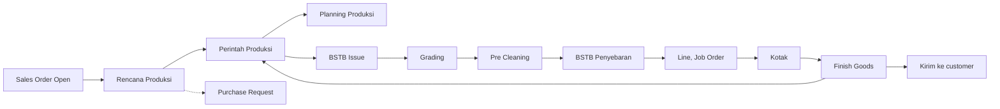

# Rencana Produksi 00: baca dulu

Menjelaskan artifact **Rencana Produksi** (`rencana-produksi.html` di folder ini). Aturannya `Perintah-Produksi-Plan.md` (P325),
cakupannya `Simulasi-Rencana-Produksi-Plan.md`. **Belum ada di aplikasi ERP**; layar baru di artifact dibangun 1:1 nanti.

## 1. Inti

> Produksi **memenuhi** Sales Order. Tidak ada barang keluar gudang, partai, atau kotak tanpa Perintah Produksi.

| Dokumen | Menjawab | Dibuat |
| --- | --- | --- |
| Rencana Produksi | Sales Order mana dikerjakan, mana duluan, barang dan bahannya ada atau belum | PPIC, disetujui |
| Perintah Produksi | Item apa, berapa, line apa, untuk Sales Order mana | Terbit dari Rencana |
| Planning Produksi | Berapa hari ini, di workstation mana | PPIC, dari Perintah |

## 2. Memakai artifact

| Bagian | Guna |
| --- | --- |
| Bilah biru di bawah | Panduan simulasi. **Bukan bagian aplikasi** |
| *Buka layar* | Ke layar langkah ini; kerjakan sendiri |
| *Kerjakan otomatis* | Simulasi mengerjakan langkah itu |
| *Simulasi n/16* | Daftar langkah, ganti hari kerja, ulangi dari awal |
| Ikon kotak di topbar | Pindah aplikasi ERP dan Produksi |
| Tombol bertanda *(diringkas)* | Dokumen yang sudah ada di aplikasi, di sini satu klik |

Menu pudar ada di aplikasi tetapi tidak disimulasikan. Data tersimpan di browser masing-masing.

## 3. Cerita contoh

Hari ini 24/11/2026. Gram dan rendemen hanya ilustrasi.

| Sales Order | Isi | Kirim |
| --- | --- | --- |
| 0001 | 10 kotak BMK50 | 12/01/2027 |
| 0002 | 8 kotak BMK50, 4 kotak BMK100 | 18/01/2027 |
| 0003 | 5 kotak IDM50, line Mie | 25/01/2027 |
| 0004 | 3 kotak BSD50 | 09/12/2026 |
| 0005 | 6 kotak BMK100, **Pra-SO** | 22/02/2027 |

Awal: FG BMK50 4 dan BSD50 3. Keping siap packing 100 g. HLS-A siap Penyebaran 150 g. BB SM-A 1.400 g, SM-SD 600 g, SM-PT 100 g.

## 4. Urutan membaca

| File | Isi |
| --- | --- |
| 01 | Rencana Produksi |
| 02 | Perintah Produksi dan hitungan kebutuhan |
| 03 | Planning Produksi dan Rencana vs Realisasi |
| 04 | Empat gerbang dan pengerjaan |
| 05 | Untuk developer: peta 1:1, tabel, fungsi, uji |
