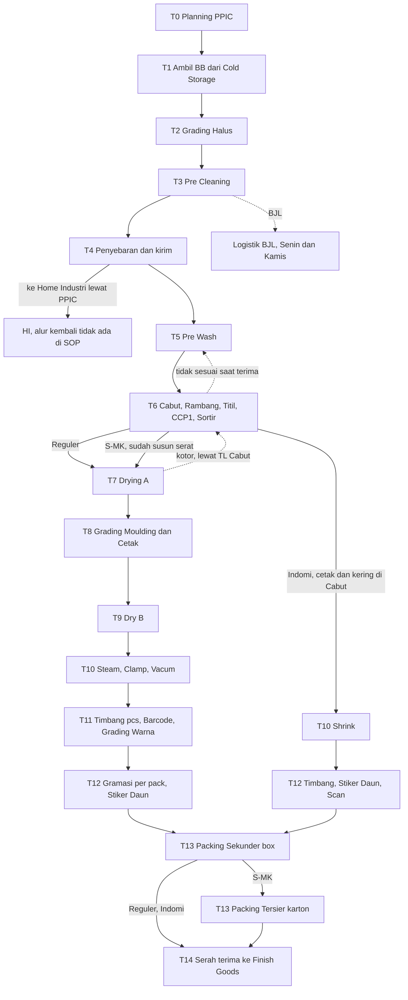

# Walet SOP: Pedoman Dasar Proses Produksi Walet

> **Sumber utama:** 45 SOP PT Akui Bird Nest Indonesia di folder `Walet SOP/` (hasil scan, dibaca per halaman).
> **Konteks pembanding:** `Produksi Walet (Real).md` (disingkat **PWR**) untuk definisi istilah dan titik yang perlu dicocokkan.
> **Sifat dokumen:** menggambarkan pekerjaan di lapangan. Bukan rancangan sistem dan bukan keputusan baru.
> **Disusun:** 05/11/2026.

**Cara membaca sumber.** Rujukan seperti `PROD.02.01` adalah nomor SOP di bagian 2. `[PWR]` berarti keterangan datang dari konteks, bukan dari SOP. Hal yang tidak pasti tidak ditebak; semuanya ada di bagian 10 dengan kode `G-nn`.

---

## 1. Tujuan, Scope, dan Batasan

**Tujuan.** Menjadi acuan bersama tentang apa yang benar-benar terjadi pada barang dari gudang sampai Finish Goods, siapa yang mengerjakan, apa yang diperiksa, dan catatan apa yang dipakai. Dokumen ini menjadi bahan dasar perancangan proses.

| Batas | Ketentuan |
| --- | --- |
| **Mulai** | Bahan baku diambil dari Cold Storage atas dasar planning (T1). Lihat G-01: SOP tidak menyebut gudang Logistik pada titik ini |
| **Selesai** | Finish Goods menerima kotak dari Produksi, memeriksa, dan mencatat di kartu stok (T14) |
| **Line** | Reguler, S-MK, Indomi. Ketiganya dicakup karena SOP memuat ketiganya |
| **Di luar scope** | Sebelum gudang: planning pembelian, pembelian, grading sampling, penerimaan BB. Sesudah FG: stiker balik, PSI, uji karantina, pengiriman, keuangan. Dicatat sebagai batas di bagian 9 |

---

## 2. Daftar SOP Sumber

**Peran:** Inti = menjelaskan tahapan dalam scope. Pendukung = aturan lintas tahapan atau batas. Luar = di luar scope, tidak dijabarkan.

### Produksi

| Kode | File | Rev / Efektif | Ringkasan | Peran |
| --- | --- | --- | --- | --- |
| PROD.01.01 | SOP Penerimaan Bahan Baku | 03, 31/07/2026 | Grading sampling, uji nitrit dan aluminium, keputusan beli atau retur, simpan di Cold Storage | Pendukung |
| PROD.02.01 | Grading Halus dan Pre Cleaning (reguler) | 03, 31/07/2026 | Planning, ambil BB, grading halus, pre cleaning, timbang per box, kirim ke Pre Wash dan HI | Inti |
| PROD.02.02 | Grading Halus dan Pre Cleaning (Indomi) | 03, 31/07/2026 | Sama, ditambah lepas serabut dan steam | Inti |
| PROD.02.03 | Grading Halus dan Pre Cleaning (SMK) | 03, 31/07/2026 | Sama, ditambah steam untuk barang putih | Inti |
| PROD.02.04 | Pre Wash | 03, 31/07/2026 | Tiga alur: Reguler, Indomie, S-MK | Inti |
| PROD.02.05-R | SOP Cabut (Reguler) | 03, 31/07/2026 | Cabut, Rambang, Titil, CCP1, Sortir | Inti |
| PROD.02.05-S | SOP Cabut (S-MK) | 03, 31/07/2026 | Cabut bertahap, CCP1, pemilahan, susun serat | Inti |
| PROD.02.06 | SOP Cabut (Indomi) | 03, 31/07/2026 | Cabut, CCP1, Sortir, cetak Indomi, pengeringan | Inti |
| PROD.02.08 | SOP Moulding | 03, 31/07/2026 | Drying, Grading Moulding, cetak, Dry B | Inti |
| PROD.02.09 | SOP Packing (reguler) | 02, 31/07/2026 | Steam, clamp dan vacum, barcode, grading warna, gramasi, box | Inti |
| PROD.02.10 | SOP Packing (Indomi) | 02 | Shrink, stiker daun, scan, box | Inti |
| PROD.02.11 | SOP Packing (S-MK) | 02 | Seperti Reguler, ditambah packing tersier karton | Inti |

### PPIC, QC

| Kode | File | Rev / Efektif | Ringkasan | Peran |
| --- | --- | --- | --- | --- |
| PPIC.01.01 | Perencanaan Produksi | 05, 16/09/2026 | SO, cek stok FG, hitung kebutuhan, planning, lead time | Pendukung |
| QC.01.01 | Sample Uji Lab BB di Dalam Pabrik | 04 | Sampling kedatangan, batas nitrit dan aluminium | Pendukung |
| QC.01.02 | Sample Uji Lab BB di Luar Pabrik | 04 | Rapid test di lokasi tengkulak | Luar |
| QC.01.03 | Pengecekan Spesifikasi Bahan Baku | 04, 15/09/2026 | Kadar air dan hasil grading, pre cleaning, penyebaran | Inti |
| QC.01.04 | Spesifikasi Pembelian RM di Luar Pabrik | 00 | Pengecekan di tengkulak | Luar |
| QC.01.05 | Pengecekan Cleaning Reguler | 02 | Prewash sampai keluar cabut | Inti |
| QC.01.06 | Pengecekan Cleaning S-MK | 03 | Sama, ditambah steam, grading serat, tapak | Inti |
| QC.01.07 | Pengecekan Cleaning Indomi | 03 | Sama, ditambah spinner dan cetak | Inti |
| QC.01.08 | Sample CCP1 di Grading Moulding | 03 | Uji nitrit dan aluminium per partai sebelum cetak | Inti |
| QC.01.09 | Pengecekan Spesifikasi Moulding | 03 | Dry A sampai Final Grading Moulding | Inti |

### Logistik

| Kode | File | Rev / Efektif | Ringkasan | Peran |
| --- | --- | --- | --- | --- |
| LOG.01.01 | Penerimaan dan Pengiriman Finish Good | 03, 15/09/2026 | Terima FG, pallet, kartu stok, surat jalan | Inti |
| LOG.02.01 | Penerimaan Barang Non Raw Material | 03, 04/08/2026 | Terima dan periksa bahan kemas dari supplier | Luar |
| LOG.02.02 | Pengeluaran Barang Non Raw Material | 05, 04/08/2026 | Permintaan user, pengeluaran, input stok | Pendukung |
| LOG.04.01 | Pengajuan Purchase Request | 04, 04/08/2026 | Permintaan satu pintu, PR. Separuh halaman 2 scan-nya hitam (G-29) | Luar |
| LOG.05.01 | Penerimaan BJL | 02, 04/08/2026 | Terima BJL Senin dan Kamis, timbang, kontainer | Pendukung |
| LOG.05.02 | Penyimpanan BJL | 03, 15/09/2026 | Kontainer per jenis, kartu stok | Pendukung |
| LOG.05.03 | Pengiriman BJL | 03, 15/09/2026 | Keluarkan BJL ke customer atau produksi | Luar |
| LOG.06.01 | Pengiriman Domestik & Ekspor | 02 | Surat jalan dan salinan dokumen | Luar |

### FAT, Purchasing, Sales

| Kode | File | Rev / Efektif | Ringkasan | Peran |
| --- | --- | --- | --- | --- |
| FAT.08.01 | Perhitungan HPP | 00, 29/09/2026 | Realisasi biaya, varian, standar cost | Pendukung |
| WI-ACC-001 | Instruksi Kerja Perhitungan HPP | 00, 01/10/2026 | Kartu stok, proporsi grading, standar cost per unit, simulasi | Pendukung |
| FA.01.01 | Penerimaan uang penjualan tunai | 00, 13/05/2024 | Kasir | Luar |
| FA.01.02 | Penerimaan uang muka transfer | 00, 13/05/2024 | Tagihan oleh Admin PPIC | Luar |
| FA.02.01 | Pengeluaran uang pembelian bahan baku | 00, 13/05/2024 | Verifikasi tagihan, bayar | Luar |
| FA.02.02 | Pengeluaran uang operasional | 00, 13/05/2024 | Verifikasi tagihan, bayar | Luar |
| FA.03.01 | Bon sementara | 00, 13/05/2024 | Pengajuan dan pengembalian bon | Luar |
| FA.03.02 | Pelaporan kas kecil | 00, 13/05/2024 | Laporan bulanan | Luar |
| FA.04.01 | Pencatatan dan penagihan piutang | 00, 13/05/2024 | Monitoring tagihan | Luar |
| FA.05.01 | Gaji karyawan | 00, 13/05/2024 | Data HRD, bayar gaji. Sumber biaya TKL | Pendukung |
| FA.06.01 | Rekonsiliasi bank | 00, 13/05/2024 | Selisih data bank | Luar |
| FA.07.01-PPN | Pelaporan dan pembayaran PPN | 00, 13/05/2024 | Faktur, selisih masukan dan keluaran | Luar |
| FA.07.02-PPh | Pelaporan dan pembayaran PPh | 00, 13/05/2024 | PPh 21, 25, 29. Nama file tertulis 07.01 (G-28) | Luar |
| PUR.01.01 | Pengadaan Barang dan Jasa | 05, 15/09/2026 | PR, PO, kedatangan, retur | Luar |
| MKT.04.01 | Penjualan | 01, 15/09/2026 | Pesanan, diskusi PPIC dan produksi, Sales Order | Pendukung |

Jumlah: 12 Produksi, 1 PPIC, 9 QC, 8 Logistik, 13 FAT, 1 Purchasing, 1 Sales = **45 file**.

---

## 3. Glosarium

### Barang dan mutu

| Istilah | Definisi | Sinonim / catatan | Sumber |
| --- | --- | --- | --- |
| SBW | Sarang burung walet, bahan yang diproses | Sarang, RM, Bahan Baku, BB | QC.01.03, QC.01.05 |
| Barang utuh | Sarang yang bentuknya masih utuh | | PROD.02.02, PROD.02.05-R |
| Barang hancuran | Pecahan yang dicuci di Rambang dan dibersihkan di Titil | Serabut, patahan | PROD.02.05-R |
| Barang serabut | Bagian serabut; di Indomi dilepas dan di-steam lebih lama | Lihat G-22 | PROD.02.02 |
| Barang virus | Barang bermasalah saat pemeriksaan bahan baku | Definisi rinci tidak ada (G-24) | PROD.01.01, QC.01.06 |
| Grade bahan | Bentuk, bulu, warna, kuantiti, kadar air | Ada di kartu stok | PROD.02.01 |
| Jenis | Kode kelas barang, seperti PT-1-BSA-KR, G2-0-0-0, KK-0-0-0 | Item/SKU [PWR] | WI-ACC-001 |
| BJL | **Waste Produk** | Barang tanpa nilai, tetapi tetap ditimbang dan bisa dijual (7.5) | LOG.05.01, WI-ACC-001 |
| BS | Barang yang tidak bisa dipakai [PWR] | Di WI-ACC-001 tetap punya harga (G-16) | WI-ACC-001 |
| G2 | Grade 2, barang tidak standar [PWR] | | WI-ACC-001 |
| Bahan bersih | Bahan dibeli sudah sesuai jenis | BB bersih [PWR]. Punya jalur lead time sendiri | PPIC.01.01 |
| BB kotor | Bahan dibeli bercampur, perlu diurai | Chong [PWR] | PWR |
| Bahan kemas | Box, plastik, stiker, karton | Non raw material, packaging material, bahan pembantu, bahan penolong [PWR] | LOG.02.01, WI-ACC-001 |
| Stiker daun | Stiker yang ditempel presisi di punggung SBW | Dicatat sebagai "stiker daun (CAIQ)" | PROD.02.09, WI-ACC-001 |

### Proses

| Istilah | Definisi | Sinonim / catatan | Sumber |
| --- | --- | --- | --- |
| Grading Kasar | Pemilahan awal sesudah barang datang | Grading sampling (G-02) | QC.01.03, PROD.01.01 |
| Grading Halus | Pemilahan rinci menurut bentuk, warna, bulu | | PROD.02.01, QC.01.03 |
| Pre Cleaning | Membersihkan flek, kaki kuning, benda asing dengan cutter dan gerinda | | PROD.02.01, QC.01.03 |
| Penyebaran | Menyiapkan bahan per jenis untuk dikirim ke cleaning | Tidak punya SOP Produksi sendiri (G-03) | QC.01.03, PPIC.01.01 |
| Pre Wash | Cuci kotor: semprot titik kotor, bilas, tiris | Cuci kotor, Prewash | PROD.02.04 |
| Cabut | Membersihkan bulu | Cleaning [PWR, sebagai unit] | PROD.02.05-R |
| Rambang | Mencuci barang hancuran | | PROD.02.05-R |
| Titil | Membersihkan barang hancuran | | PROD.02.05-R |
| CCP1 | Pencucian untuk menurunkan nitrit | Cuci nitrit | PROD.02.05-R |
| Sortir | Memeriksa hasil cabut; di Reguler sekaligus mencetak hancuran | Checker di SOP QC | PROD.02.05-R, QC.01.05 |
| Drying A | Pengeringan sesudah cabut | Dry A | PROD.02.08, QC.01.09 |
| Grading Moulding | Penimbangan dan pembagian ke operator moulding | | PROD.02.08 |
| Moulding | Mencetak pada bola cetak | Cetak | PROD.02.08 |
| Dry B | Pengeringan, pencetikan, timbang | | PROD.02.08 |
| Steam | Pemanasan; ada di bahan baku (Indomi, S-MK) dan sebelum wrapping (Reguler, S-MK) | WIP Steam | PROD.02.02, PROD.02.09 |
| Wrapping | Clamp dan vacum, atau shrink di Indomi | | PROD.02.09, PROD.02.10 |
| Barcoding | Grading warna, scan, gramasi per pack | Final grading? (G-06) | PROD.02.09 |
| Packing primer, sekunder, tersier | Kemasan vacum atau shrink; box; karton | Tersier hanya S-MK | PROD.02.11 |
| Release | QC menempel stiker QC Passed pada box dan menstempel BSTB | | PROD.02.01 |
| Hold | Barang ditahan karena tidak sesuai | | QC.01.03, QC.01.09 |

### Identitas dan catatan

| Istilah | Definisi | Sumber |
| --- | --- | --- |
| BSTB | Bukti Serah Terima Barang (FRM.PROD.00.04), ditandatangani pengirim dan penerima, diketahui atasan keduanya | PROD.02.01 |
| Kartu Stok | Catatan barang masuk dan keluar | PROD.02.01, LOG.01.01 |
| Nomor Job | Nomor kelompok barang. Pembagian kerja di Cabut dilakukan per Nomor Job | PROD.02.05-R, PROD.02.08 |
| Partai | Satuan kelompok produksi; dipakai pada kuantiti, uji CCP1, dan closing di packing | PROD.02.05-R, QC.01.08, PPIC.01.01 |
| Barcode | Label identitas; dicek saat Pre Wash dan Cabut, ditempel per pcs di Wrapping | QC.01.05, PROD.02.09 |
| Scan in / Scan out | Scan memasukkan jumlah barang ke data packing / mengeluarkan data untuk pengiriman | PROD.02.09 |
| No. Stok | Identitas stok; SOP tidak memakai istilah ini | PWR |
| Persiapan / Stand By | Barang diterima belum dikerjakan / selesai menunggu kirim. SOP tidak memakai istilah ini | PWR |

---

## 4. Peran dan Departemen

| Peran | Tanggung jawab dalam scope | Sumber |
| --- | --- | --- |
| SPV PPIC | Memberi planning grading halus dan planning produksi; menerima barang untuk HI | PROD.02.01, PPIC.01.01 |
| SPV Bahan Baku | Menerima planning, memastikan simpanan Cold Storage dan kartu stok, serah terima ke Pre Wash | PROD.01.01, PROD.02.01 |
| TL Bahan Baku | Mengambil BB dari Cold Storage, mengirim ke Pre Wash (Indomi, S-MK) | PROD.02.01, PROD.02.02 |
| Operator Grading / Pre Cleaning / Timbang | Grading halus, pre cleaning, timbang per box | PROD.02.01 |
| Admin Bahan Baku | Input timbangan, membuat BSTB | PROD.02.01 |
| TL / Operator Pre Wash | Cek BSTB dan kadar air; cuci, tiris | PROD.02.04 |
| TL Cabut, Operator Cabut, Rambang, Titil, CCP1, Sortir | Cek terima, bagi per Nomor Job, bersihkan, cuci, sortir | PROD.02.05-R |
| TL / Admin Drying, Operator Drying | Terima, scan, keringkan, semprot, timbang, kirim | PROD.02.08 |
| Admin Moulding, Operator Grading Moulding, Operator Moulding, TL Moulding, Operator Dry B | Scan Job, timbang bagi, cetak, cek, keringkan, buat BSTB | PROD.02.08 |
| Admin / Operator / TL Wrapping | Terima, timbang, steam, clamp vacum, barcode | PROD.02.09 |
| Admin / Operator Barcoding | Grading warna, scan, gramasi, stiker daun | PROD.02.09 |
| Operator / Admin Packing | Box, karton, BSTB ke FG | PROD.02.09 |
| QC Field / QCP | Sampling di setiap tahap dan release | QC.01.03 |
| QC Lab | Uji nitrit dan aluminium | QC.01.08 |
| GTL dan TL (semua unit) | Pemeriksaan higiene awal shift | PROD.02.01 |
| Health Officer | Menerima laporan karyawan sakit dari GTL | PROD.02.01 |
| Admin Finish Goods, SPV Logistik | Terima FG, pallet, kartu stok | LOG.01.01 |
| Admin / Operator Logistik | Terima BJL, keluarkan bahan kemas | LOG.05.01, LOG.02.02 |
| Accounting | Hitung HPP dan standar cost | FAT.08.01 |

---

## 5. Overview Flow End-to-End

**Narasi singkat.** PPIC memulai pekerjaan lewat planning. Bahan keluar dari Cold Storage, digrading halus, dibersihkan, lalu disiapkan per box untuk cleaning sendiri atau Home Industri. Setelah dicuci dan dicabut bulunya, jalur terpisah: Reguler dicetak di Moulding, S-MK sudah disusun di Cabut, dan Indomi selesai dicetak dan dikeringkan di Cabut lalu langsung ke Packing. Semua berakhir di box, dan S-MK ditambah karton, sebelum diserahkan ke Finish Goods.

**Tiga pola yang berulang di tiap serah terima:**

1. Penerima mencocokkan fisik dengan BSTB.
2. Hasil tidak sesuai kembali ke langkah yang sama; tidak ada keluar jalur kecuali yang disebut di 7.4.
3. QC Field me-release barang sebelum dikirim.

---

## 6. Detail per Tahapan

Perbedaan antar line ada di dalam tiap tahap pada baris **Beda line**. Bila tidak ada baris itu, ketiga line sama.

### T0. Planning (pemicu)

| Unsur | Isi |
| --- | --- |
| Tujuan | Memberi acuan kerja bagi unit produksi |
| Pelaku | SPV PPIC, SPV Bahan Baku, SPV Packing |
| Input | Sales Order FRM.MKT.04.01, stok FG, update stok tiap workstation H+1 |
| Langkah | 1. Cek stok FG. 2. Stok cukup: buat planning untuk packing. 3. Stok kurang: hitung BB, bahan kemas, lead time. 4. Bila tersedia, buat planning penyebaran, cleaning, dan moulding. 5. Serahkan planning grading halus ke SPV Bahan Baku |
| Keputusan | Stok FG memenuhi? BB dan kemas tersedia? |
| Output | Planning Produksi FRM.PPIC.01.02, 3 hari kerja sebelum tanggal produksi |
| Handoff | Ke SPV Bahan Baku (T1), atau SPV Packing bila hanya packing |
| Sumber | PPIC.01.01, PROD.02.01, MKT.04.01 |

### T1. Pengambilan Bahan Baku

| Unsur | Isi |
| --- | --- |
| Tujuan | Menyediakan bahan untuk grading halus |
| Pelaku | SPV Bahan Baku, TL Bahan Baku |
| Input | Planning grading halus; BB di Cold Storage |
| Langkah | 1. SPV menerima planning. 2. TL mengambil BB dari Cold Storage |
| Kontrol | Tidak disebut. Cold Storage maksimum 5°C, box tertutup rapat (QC.01.03) |
| Output | BB di area grading. Tidak ada dokumen disebut (G-01) |
| Handoff | Ke Operator Grading |
| Sumber | PROD.02.01, PROD.02.02, PROD.02.03, QC.01.03 |

### T2. Grading Halus

| Unsur | Isi |
| --- | --- |
| Tujuan | Memilah bahan menurut standar jenis |
| Pelaku | Operator Grading, QC Field, TL Grading Halus |
| Input | BB dari Cold Storage |
| Langkah | 1. Operator grading halus. 2. QC sampling hasil per operator. 3. Sesuai: lanjut. 4. Tidak: dipilah kembali |
| Kontrol | FRM.QC.01.17. Kadar air sesudah grading halus 29–31%. Sampel 8%. Periksa bentuk, warna, bulu |
| Output | Barang terpilah. Bila belum diproses, simpan di box tertutup di Cold Storage maks 5°C |
| Handoff | Ke Operator Pre Cleaning |
| Sumber | PROD.02.01–03, QC.01.03 |

### T3. Pre Cleaning

| Unsur | Isi |
| --- | --- |
| Tujuan | Membersihkan flek, kaki kuning, benda asing |
| Pelaku | Operator Pre Cleaning, QC Field, TL Precleaning |
| Input | Hasil grading halus |
| Langkah | 1. QC sampling berat dan kadar air sebelum proses. 2. Cutter. 3. QC cek hasil cutter. 4. Gerinda. 5. QC cek hasil gerinda. 6. QC menimbang hasil dan BJL |
| Kontrol | FRM.QC.01.18, STD.QC.02.01. Tidak sesuai: hold, dibersihkan ulang. Kadar air lihat G-09 |
| Output | Barang bersih; BJL Pre Cleaning tertimbang |
| Handoff | Ke T4; BJL ke Logistik (7.5) |
| Sumber | PROD.02.01–03, QC.01.03 |

### T4. Penyebaran dan Pengiriman ke Cleaning

| Unsur | Isi |
| --- | --- |
| Tujuan | Menyiapkan bahan per jenis sesuai planning, lalu mengirim |
| Pelaku | SPV PPIC, SPV dan Admin Bahan Baku, Operator Timbang, QC Field, TL Penyebaran |
| Input | Planning produksi (penyebaran HI dan JBG untuk Home Industri, serta kebutuhan cleaning AKUI OBI) |
| Langkah | 1. SPV menerima planning. 2. QC cek kesesuaian jenis. 3. Timbang per box. 4. Admin input dan buat BSTB. 5. QC release. 6. Kirim dan serah terima |
| Kontrol | Jenis tidak sesuai: TL Penyebaran mengganti RM. Release gagal: kembali ke timbang |
| Output | Box ber-stiker QC Passed; BSTB berstempel |
| Handoff | Ke TL Pre Wash. Bagian HI ke SPV PPIC dengan FRM.LOG.02.03 dan FRM.PPIC.01.01 |
| Beda line | **Indomi:** timbang dan lepas serabut, lalu steam (utuh 1 menit; serabut 1 menit 20 detik). **S-MK:** timbang, lalu steam (barang putih 1 menit; warna lain tidak di-steam, lihat G-11) |
| Sumber | PROD.02.01–03, QC.01.03 |

### T5. Pre Wash

| Unsur | Isi |
| --- | --- |
| Tujuan | Menghilangkan pasir, kayu, kontaminan fisik tanpa merusak serat |
| Pelaku | TL dan Operator Pre Wash, QC Field |
| Input | Box dan BSTB dari Bahan Baku |
| Langkah | 1. TL cek pcs dan warna terhadap BSTB. 2. QC cek kadar air, kebersihan, berat, keutuhan. 3. Cuci: semprot titik kotor, bilas air mengalir. 4. Tiris. 5. TL cek kadar air. 6. QC sampling hasil cuci. 7. Release. 8. Kirim |
| Kontrol | Form Pengecekan Pre Wash. Sikat gigi hitam, air RO, tanpa kimia. Kadar air pengipasan: basah >65% dikeringkan; kering <50% dibasahi. Tidak ada pasir timbul, warna sesuai |
| Selisih terima | Kurang ditambah SBW, lebih dikembalikan ke Penyebaran (QC.01.05) |
| Output | Barang bersih, QC Passed |
| Handoff | Ke TL Cabut, BSTB |
| Beda line | **Indomi:** barang utuh dicuci dan dicabut bulu besar; serabut lewat Rambang atau cuci, langsung ke QC. **S-MK:** cuci dan lepas serabut; sesudah QC ada pemotongan kaki, lalu release |
| Sumber | PROD.02.04, QC.01.05–07 |

### T6. Cabut

Mencakup Cabut, Rambang, Titil, CCP1, dan Sortir, karena semuanya berada di satu workstation dan satu BSTB keluar.

| Unsur | Isi |
| --- | --- |
| Tujuan | Membersihkan bulu, pasir, benda asing, dan menurunkan nitrit, dengan menjaga keutuhan |
| Pelaku | TL Cabut, Operator Cabut, Rambang, Titil, CCP1, Sortir, QC Field, QC Lab |
| Input | Barang dan BSTB; harus ada Nomor Job |
| Langkah | 1. TL cek pcs, kadar air, kuantiti per box dan/atau partai, warna. 2. QC cek kebersihan dan kesesuaian barcode. 3. TL membagi per Nomor Job. 4. Barang utuh: Operator Cabut. 5. Hancuran: Rambang lalu Titil. 6. TL cek. 7. QC cek. 8. CCP1. 9. QC cek hasil CCP1. 10. Sortir cek dan cetak hancuran. 11. QC cek hancuran dan keutuhan. 12. Release. 13. Kirim |
| Kontrol | FRM.QC.01.01. Kadar air terima: VIP 25–28%, PB 29–32%, Krem 30–32%. CCP1 air RO, sekali pada satu keping, sikat gigi hitam, dicatat 3x per operator; waktu lihat G-08. Fisik beda BSTB: TL menulis selisih dan mengembalikan ke Pre Wash dengan BSTB |
| Output | SBW di atas bola-bola, tersusun di sesek, QC Passed |
| Handoff | Ke unit Drying, BSTB (Reguler, S-MK); ke Packing (Indomi) |
| Beda line | **S-MK:** cabut bulu besar/hitam, tiris, cabut bulu kecil, QC; lalu Rambang-Titil dan CCP1-Sortir; pemilahan warna dan serat; susun serat pada cetakan dan tapak; Admin Cabut SMK out data dan BSTB. **Indomi:** sesudah Sortir, serat dicampur dan dikeringkan spinner, dicetak di cetakan stainless, dikeringkan 7–8 jam, disortir sesudah kering, lalu release |
| Sumber | PROD.02.05-R, PROD.02.05-S, PROD.02.06, QC.01.05–07 |

### T7. Drying A

| Unsur | Isi |
| --- | --- |
| Tujuan | Mengeringkan hasil cabut sampai kadar air standar |
| Pelaku | TL dan Admin Drying, Operator Drying, QC Field |
| Input | Barang dan BSTB dari Cabut |
| Langkah | 1. TL menerima. 2. Admin scan dan cek barcode, input data. 3. Operator drying, penyemprotan, timbang. 4. QC sampling. 5. Release. 6. Kirim |
| Kontrol | FRM.QC.01.11, STD.QC.03.01. Kadar air 11–12%. Kipas 7–8 jam. Kotor: TL Dry A menyerahkan ke TL Cabut, checker membersihkan, masuk ulang Drying A |
| Output | Barang kering, QC Passed |
| Handoff | Ke Admin Moulding, BSTB |
| Sumber | PROD.02.08, QC.01.09 |

### T8. Grading Moulding dan Cetak

| Unsur | Isi |
| --- | --- |
| Tujuan | Membagi barang dan mencetak bentuk |
| Pelaku | Admin Moulding, Operator Grading Moulding, Operator Moulding, TL Moulding, QC Field, QC Lab, SPV Moulding |
| Input | Barang dan BSTB dari Drying |
| Langkah | 1. Admin scan Nomor Job. 2. Timbang untuk pembagian. 3. QC ambil sampel per partai dari hasil Grading Moulding. 4. Lab uji. 5. Lolos: SPV Moulding diberi tahu SBW dapat dicetak. 6. Operator cetak. 7. TL cek. 8. QC sampling. 9. Serahkan ke Dry B |
| Kontrol | **Nitrit <30 ppm, Aluminium <50 ppm.** Sampel AQL 6,5 tabel 2 (STD.QC.07.01), FRM.QC.02.03. Gagal: treatment sebelum cetak lalu uji ulang. Treatment nitrit: rendam air ozone. Nitrit dan aluminium: Organic Prebiotics, masih trial. Cetak: serat, isi kakian, kebersihan |
| Output | Barang tercetak |
| Handoff | Ke Operator Dry B |
| Beda line | **Reguler:** mulai susun serat pada cetakan, tekan, cetak di bola cetak. **S-MK:** mulai dari tekan dan cetak. **Indomi:** tidak lewat tahap ini |
| Sumber | PROD.02.08, QC.01.08, QC.01.09 |

### T9. Dry B

| Unsur | Isi |
| --- | --- |
| Tujuan | Mengeringkan hasil cetak dan menyiapkan kirim ke Packing |
| Pelaku | Operator Dry B, TL Dry B, QC Field, Admin Moulding, SPV |
| Input | Hasil cetak |
| Langkah | 1. Pengeringan. 2. QC sampling cetak. 3. Pencetikan. 4. Timbang 500 gram (G-23). 5. QC cek akhir. 6. Release. 7. Admin buat BSTB output data. 8. Approval SPV. 9. Kirim |
| Kontrol | FRM.QC.01.10, STD.QC.04.01 bentuk, STD.QC.04.02 warna. Tidak sesuai: hold, TL memperbaiki kualitas cetak. Sebelum kirim: FRM.QC.01.11, kebersihan, bentuk, serat |
| Output | Barang QC Passed, BSTB |
| Handoff | Ke unit Final Grading menurut PROD.02.08; ke WS Packing menurut QC.01.09 (G-06). Penerima di PROD.02.09: Admin Wrapping |
| Sumber | PROD.02.08, QC.01.09 |

### T10. Steam dan Wrapping

| Unsur | Isi |
| --- | --- |
| Tujuan | Packing primer |
| Pelaku | Admin, Operator, TL Wrapping, QC Field |
| Input | Barang dan BSTB ber-approval dari Moulding |
| Langkah | 1. Terima. 2. Timbang persiapan steam. 3. Steam. 4. QC sampling kadar air. 5. Clamp dan vacum. 6. TL cek. 7. QC sampling |
| Kontrol | Kadar air 11–12%, FRM.QC.01.11. FRM.QC.01.04. Waktu dan suhu steam menurut verifikasi mesin pemanas. Gagal kadar air: kembali ke timbang. Gagal wrapping: kembali ke shrink atau vacum |
| Output | Barang terkemas primer |
| Handoff | Ke timbang per pcs (T11) |
| Beda line | **Indomi:** tanpa steam, clamp, dan vacum; proses shrink |
| Sumber | PROD.02.09–11 |

### T11. Timbang per Pcs, Barcode, Grading Warna

| Unsur | Isi |
| --- | --- |
| Tujuan | Memberi identitas per keping dan mengelompokkan warna |
| Pelaku | Operator Wrapping, Operator dan Admin Barcoding |
| Input | Barang terkemas primer |
| Langkah | 1. Timbang per pcs. 2. Tempel stiker barcode. 3. Grading warna. 4. Scan in |
| Kontrol | Tidak ada form khusus disebut |
| Output | Pcs ber-barcode, masuk data packing |
| Handoff | Ke Operator Barcoding, tahap gramasi |
| Beda line | **Indomi:** tidak ada grading warna. Timbang dan stiker daun, lalu scan in |
| Sumber | PROD.02.09–11 |

### T12. Gramasi per Pack dan Stiker Daun

| Unsur | Isi |
| --- | --- |
| Tujuan | Menyusun isi pack sesuai gramasi |
| Pelaku | Operator Barcoding, QC Field |
| Input | Pcs ber-barcode |
| Langkah | 1. Hitung gramasi per pack. 2. Tempel stiker daun, stiker burung presisi di punggung. 3. QC sampling. 4. Scan out, kirim ke unit Packing |
| Kontrol | Form Packing 95, FRM.QC.01.05. Gagal: kembali ke penghitungan |
| Output | Pack siap box. PPIC menyebut tingkat ini "tersedia di packing 95" |
| Handoff | Ke Operator Packing |
| Beda line | **Indomi:** tanpa FRM.QC.01.05; scan out langsung |
| Sumber | PROD.02.09–11, PPIC.01.01 |

### T13. Packing Sekunder dan Tersier

| Unsur | Isi |
| --- | --- |
| Tujuan | Mengemas ke box dan menyiapkan serah terima |
| Pelaku | Operator dan Admin Packing, QC Field |
| Input | Pack sesudah scan out; box dan bahan kemas |
| Langkah | 1. Packing sekunder (box). 2. QC sampling. 3. Release. 4. Admin Packing buat BSTB ber-approval |
| Kontrol | Form Final Packing FRM.QC.01.08. Gagal: packing ulang |
| Output | Box QC Passed; BSTB |
| Handoff | Ke Admin Finish Goods |
| Beda line | **S-MK:** ditambah packing tersier (karton), Form Cartoning FRM.QC.01.09, sebelum release |
| Sumber | PROD.02.09–11 |

### T14. Serah Terima ke Finish Goods

| Unsur | Isi |
| --- | --- |
| Tujuan | Memindahkan tanggung jawab ke Finish Goods |
| Pelaku | Admin Finish Goods, Admin Packing |
| Input | Barang dan BSTB FRM.PROD.00.04 |
| Langkah | 1. Terima. 2. Cek fisik terhadap BSTB, jenis dan quantity. 3. Catat barang masuk. 4. Handling ke pallet, dikelompokkan per penerimaan. 5. Update stok |
| Kontrol | Tidak sesuai: konfirmasi ke produksi untuk pengembalian barang atau revisi BSTB |
| Output | Kartu Stok FRM.LOG.01.01 terbarui |
| Handoff | Selesai scope. Lanjut pengiriman (bagian 9) |
| Sumber | LOG.01.01 |

---

## 7. Konsep Kunci Lintas Tahapan

### 7.1 Tiga line dalam satu fasilitas

| Tahap | Reguler | S-MK | Indomi |
| --- | --- | --- | --- |
| Steam bahan baku | Tidak | Hanya putih | Ya, utuh dan serabut |
| Lepas serabut | Tidak | Di Pre Wash | Sebelum steam |
| Potong kaki | Tidak | Di Pre Wash | Tidak |
| Pencetakan | Di Moulding; hancuran di Sortir | Susun di Cabut, tekan di Moulding | Di Cabut |
| Drying A, Moulding, Dry B | Ya | Ya | Tidak; kering di Cabut |
| Steam sebelum wrapping | Ya | Ya | Tidak |
| Kemasan primer | Clamp, vacum | Clamp, vacum | Shrink |
| Grading warna | Ya | Ya | Tidak |
| Packing tersier | Tidak | Ya | Tidak |

Sumber: PROD.02.01–11, QC.01.05–07.

### 7.2 Identitas barang

Pada lapangan, barang dikenali lewat empat hal: **barcode, Nomor Job, partai, dan jenis**. Barcode sudah ada sebelum Pre Wash (QC.01.05), dicek di Drying, dan ditempel ulang per pcs di Wrapping. Nomor Job wajib ada saat Cabut menerima, dipakai membagi kerja, dan di-scan saat masuk Moulding. Partai dipakai pada kuantiti, sampling CCP1, dan closing di packing.

WI-ACC-001 mencatat bahwa partai bercampur di Grading Halus, sehingga simulasi costing tidak bisa dimulai dari grading kasar dan hanya berjalan dari sesudah Grading Halus sampai Barcoding.

### 7.3 Kontrol mutu

- **Sampling QC Field** ada di setiap tahap, dengan form sendiri (bagian 8.3).
- **Release** selalu dalam bentuk yang sama: stiker QC Passed pada box dan stempel pada BSTB.
- **CCP1** adalah titik kritis keamanan pangan. Barang tidak boleh dicetak sebelum hasil uji lolos.
- **Referensi:** RSNI3 CXC 1:1969 bagian 8 dan 13; SK Deputi Karantina Hewan Barantin No. 22/2026 untuk ekspor SBW ke RRT.

### 7.4 Penanganan barang tidak sesuai

| Kondisi | Tindakan | Sumber |
| --- | --- | --- |
| Hasil kerja tidak sesuai | Ulang di langkah yang sama | Semua PROD |
| Fisik beda BSTB saat terima | Tulis selisih, kembalikan dengan BSTB | PROD.02.05-R |
| Hasil cuci kotor saat masuk Cabut | TL Cabut komplain, tukar dengan barang baru | QC.01.05 |
| S-MK: pasir tanam parah, semupink full daun, virus lebih dari 1 titik | Retur ke Pre Wash, dikeringkan, retur ke Penyebaran; operator diberi barang bagus gramasi sama | QC.01.06 |
| Dry A masih kotor | Kembali ke Cabut, masuk ulang Drying A | QC.01.09 |
| Cetak tidak sesuai | Hold, diperbaiki TL | QC.01.09 |
| Nitrit atau aluminium gagal | Treatment, uji ulang | QC.01.08 |
| SBW rusak jadi siwir | TL Cabut mengevaluasi karyawan | QC.01.05 |

SOP tidak memuat istilah Reject atau Reproses sebagai kejadian resmi (G-14).

### 7.5 BJL

BJL adalah waste produk. Yang dicatat: BJL hasil Pre Cleaning ditimbang QC, barang virus yang tetap dibeli masuk stok waste/BJL, Logistik menerima BJL **Senin dan Kamis** dengan BSTB, berat BSTB disesuaikan dengan timbangan, disimpan di kontainer per jenis berlabel, dan kartu stok diperbarui.

BJL bisa dijual; salinan surat jalannya diberikan ke Purchasing & Exim. Pada perhitungan, BJL bernilai nol dan bebannya masuk ke produk utama dan turunan. Sumber: QC.01.03, PROD.01.01, LOG.05.01–03, LOG.06.01, WI-ACC-001.

### 7.6 Susut dan yield

SOP tidak memuat batas susut. Yang ada hanya data contoh: 80.690 g datang menjadi 79.136 g kering, susut proses 1,926% (WI-ACC-001). Penimbangan terjadi di hampir setiap tahap, tetapi perhitungan susut per tahap tidak dijelaskan (G-15).

### 7.7 Nilai barang dan biaya

| Unsur | Praktik saat ini | Sumber |
| --- | --- | --- |
| Persediaan BB | Kartu stok moving average per gram | WI-ACC-001 |
| Pembagian nilai grading | Proporsi **harga standar (harga pasar) yang ditetapkan PPIC**: berat × estimasi harga, disesuaikan selisih terhadap modal | WI-ACC-001 |
| BJL | Nilai nol, dibebankan ke produk lain | WI-ACC-001 |
| Tenaga kerja langsung | Gaji, lembur, insentif per fase | WI-ACC-001, FA.05.01 |
| Overhead | Anggaran dibagi cost driver: jumlah unit, jumlah orang, kWh, luasan | WI-ACC-001 |
| Standar cost | Direview per 3 bulan atau saat ada perubahan signifikan | FAT.08.01 |
| Realisasi | Data realisasi TKL dan overhead direview, muncul varian, dijurnal | FAT.08.01 |

Fase biaya: **Bahan Baku** (Grading Kasar, Grading Halus, Pre Cleaning), **Produksi** (Pre Wash, Cabut, Rambang, CCP1, Dry A, Moulding-Dry B, Wrapping, Packing), **Finish Good** (Logistik).

### 7.8 Perencanaan dan pelaporan

PPIC menerima update stok tiap workstation H+1 dan laporan planning vs realisasi harian, mingguan, dan bulanan dari produksi. Sumber: PPIC.01.01.

---

## 8. Aturan dan Parameter

### 8.1 Kadar air

| Titik | Standar | Sumber |
| --- | --- | --- |
| Di tengkulak (di luar pabrik) | 35–36% | QC.01.04 |
| BB datang | 30–34% | QC.01.03 |
| Sesudah grading kasar | 30–34% | QC.01.03 |
| Sesudah grading halus | 29–31% | QC.01.03 |
| Pre cleaning | 25–28% vs 30–32% (G-09) | PROD.02.01, QC.01.03 |
| Pengipasan sesudah Pre Wash | Tidak >65%, tidak <50% | QC.01.05 |
| Sesudah pengeringan / masuk Cabut | VIP 25–28%, PB 29–32%, Krem 30–32% | PROD.02.04, PROD.02.05-R |
| Hasil Drying A | 11–12% | QC.01.09 |
| Moulding dan packing | 11–12% | PROD.02.08, PROD.02.09 |

### 8.2 Keamanan dan proses

| Parameter | Nilai | Sumber |
| --- | --- | --- |
| Nitrit BB di pabrik | ≤150 ppm | QC.01.01, PROD.02.01 |
| Aluminium BB di pabrik | ≤100 ppm | QC.01.01, PROD.02.01 |
| Nitrit BB di luar pabrik | ≤100 ppm | QC.01.02 |
| Aluminium BB di luar pabrik | ≤50 ppm | QC.01.02 |
| Nitrit sesudah CCP1 | <30 ppm | QC.01.08 |
| Aluminium sesudah CCP1 | <50 ppm | QC.01.08 |
| Sampling lab | AQL 6,5, Inspection Level II, STD.QC.07.01 | PROD.02.05-R, QC.01.08 |
| Waktu CCP1 | 30 detik, maksimum atau minimum (G-08) | PROD.02.05-R, PROD.02.06 |
| Sampel grading | 8% berat tiap jenis | QC.01.03 |
| Cold Storage | Maks 5°C | QC.01.03 |
| Steam Indomi | Utuh 1 menit, serabut 1 menit 20 detik | PROD.02.02 |
| Steam S-MK | Putih 1 menit; lainnya tidak | PROD.02.03 |
| Pengeringan | 7–8 jam, kipas | PROD.02.08, PROD.02.06 |
| Higiene | Seragam, kuku, suhu badan, kulit tangan, tiap awal shift oleh TL | Semua PROD |

### 8.3 Form per tahap

| Tahap | Form |
| --- | --- |
| T0 | FRM.PPIC.01.02 Planning Produksi |
| T2 | FRM.QC.01.17 |
| T3 | FRM.QC.01.18 |
| T4 | BSTB, FRM.LOG.02.03, FRM.PPIC.01.01 |
| T5 | Form Pengecekan Pre Wash (kode lihat G-27) |
| T6 | FRM.QC.01.01 |
| T7 | FRM.QC.01.11 |
| T8 | FRM.QC.02.03, Form Pengecekan Moulding |
| T9 | FRM.QC.01.10, FRM.QC.01.11 |
| T10 | FRM.QC.01.11, FRM.QC.01.04 |
| T12 | FRM.QC.01.05 |
| T13 | FRM.QC.01.08, FRM.QC.01.09 (S-MK) |
| T14 | FRM.PROD.00.04, FRM.LOG.01.01 |
| Steam S-MK, Indomi | FRM.QC.01.03 |

### 8.4 Waktu

| Aturan | Nilai | Sumber |
| --- | --- | --- |
| SO, barang di FG | 14 hari kerja sebelum kirim | PPIC.01.01 |
| SO, barang di packing 95 | 18 hari kerja | PPIC.01.01 |
| SO, perlu produksi, BB tersedia | 33 hari kerja | PPIC.01.01 |
| SO, perlu produksi, BB belum tersedia | 45 hari kerja | PPIC.01.01 |
| Planning pembelian BB | 15 hari kerja sebelum produksi | PPIC.01.01 |
| Planning produksi | 3 hari kerja sebelum produksi | PPIC.01.01 |
| Revisi permintaan | 13 hari kerja sebelum kirim, bila stok di FG | PPIC.01.01 |
| Prewash sampai closing partai di packing | 14 hari kerja | PPIC.01.01 |
| Penerimaan BJL | Senin dan Kamis | LOG.05.01 |

### 8.5 Standar cost per gram (contoh)

| Bagian | Rp/gram | Bagian | Rp/gram |
| --- | ---: | --- | ---: |
| Pre Cleaning | 94,33 | Rambang | 343,84 |
| Grading Halus | 41,28 | Moulding | 515,48 |
| Prewash | 369,30 | Wrapping | 73,28 |
| Cabut bulu | 791,37 | Packing | 83,90 |
| CCP1 | 345,85 | Finish Goods | 31,56 |

Moulding dan Wrapping tidak berlaku untuk Indomi. Sumber: WI-ACC-001.

---

## 9. Interface dengan Proses di Luar Scope

| Batas | Dari | Ke | Yang diserahkan | Catatan | Sumber |
| --- | --- | --- | --- | --- | --- |
| Masuk BB | Purchasing RM, Grading Sampling | Cold Storage, SPV Bahan Baku | BB dan kartu stok | Retur bila nitrit, aluminium, atau virus tidak sesuai; bisa tetap dibeli | PROD.01.01 |
| Masuk bahan kemas | Logistik | User produksi | Form permintaan disetujui SPV/Manajer, Form Pengeluaran | Stok kosong: PR ke Purchasing | LOG.02.02 |
| Keluar ke HI | SPV Bahan Baku | SPV PPIC, HI | FRM.LOG.02.03, FRM.PPIC.01.01 | Alur kembali tidak ada (G-12) | PROD.02.01 |
| Keluar BJL | Produksi | Logistik | BSTB | Senin dan Kamis | LOG.05.01 |
| Keluar FG | Packing | Admin FG | BSTB | Pallet per penerimaan | LOG.01.01 |
| Sesudah FG | Logistik | Customer | Surat jalan FRM.LOG.02.04 | Stiker balik 1 hari, PSI 1 hari, uji karantina 10 hari kerja | PPIC.01.01, LOG.01.01 |

---

## 10. Gap, Inkonsistensi, dan Pertanyaan Terbuka

### A. Batas dan alur

| Kode | Masalah | Sumber | Pertanyaan |
| --- | --- | --- | --- |
| G-01 | PWR memulai produksi dari BSTB Logistik ke Grading Halus. SOP: TL Bahan Baku mengambil dari Cold Storage tanpa dokumen, dan kartu stok ada di Bahan Baku. Simulasi WI-ACC-001 memuat kolom Logistik BSTB_LOG | PROD.02.01, WI-ACC-001, PWR | Siapa pemilik stok BB dan dokumen apa yang dipakai saat bahan keluar? |
| G-02 | Grading Kasar dan Grading Sampling memakai form sama (FRM.QC.01.16) | PROD.01.01, QC.01.03 | Apakah satu proses? |
| G-03 | Penyebaran tidak punya SOP Produksi; PROD.02.01 menyebutnya hanya di keterangan. Grading di Penyebaran dan pembentukan partai tidak disebut | PROD.02.01, QC.01.03, PWR | Di mana penyebaran dikerjakan dan apa yang terjadi di sana? |
| G-04 | SOP.PROD.02.07 tidak ada di folder, nomor melompat dari 02.06 ke 02.08 | Folder | Apakah ada SOP yang belum dikumpulkan? Bisa jadi Drying |
| G-05 | SOP Moulding tidak menyebut pencampuran partai, No. Moulding, atau Job Order. Yang tertulis hanya timbang dan bagi ke operator | PROD.02.08, PWR | Apakah pencampuran memang terjadi di Grading Moulding? |
| G-06 | Final Grading: PROD.02.08 menyebut unit tujuan sesudah Dry B; QC.01.09 menyebut bagian dari Moulding; PROD.02.09 mengatakan revisi menambah alur final grading, tetapi langkahnya tidak dinamai begitu; WI-ACC-001 menaruhnya sebelum packing | PROD.02.08, QC.01.09, PROD.02.09, WI-ACC-001 | Final Grading ada di mana dan siapa pelakunya? |
| G-07 | Packing 95 di SOP adalah gramasi dan stiker daun, sementara box adalah Final Packing. PWR memakai Packing 95 = kotak, Packing 98 = kardus. Packing 98 tidak ada di SOP | PROD.02.09, PWR | Apa arti 95 dan 98? Apakah Reguler memakai kardus? |

### B. Parameter yang bertentangan

| Kode | Masalah | Sumber | Pertanyaan |
| --- | --- | --- | --- |
| G-08 | CCP1 **maksimal** 30 detik (Cabut Reguler, QC.01.05–07) vs **minimal** 30 detik (Cabut S-MK, Indomi) | PROD.02.05-R, PROD.02.05-S, PROD.02.06, QC.01.05–07 | Yang mana? Ini titik keamanan pangan |
| G-09 | Kadar air pre cleaning 25–28% vs 30–32% (di bawah 30% sulit) | PROD.02.01, QC.01.03 | Yang mana? |
| G-10 | Lokasi uji nitrit: di proses cabut dan CCP1 (Cabut) vs Grading Moulding (QC). Sampling per partai hanya di QC.01.08 | PROD.02.05-R, QC.01.08 | Apakah ada dua uji? |
| G-11 | S-MK: hanya putih di-steam (PROD.02.03) vs semua bahan S-MK di-steam (QC.01.06) | PROD.02.03, QC.01.06 | Yang mana? |
| G-21 | QC.01.03 menyebut penyemprotan sampai 30–35%, tetapi standar 30–34% | QC.01.03 | Batas atasnya berapa? |

### C. Konsep yang tidak lengkap

| Kode | Masalah | Sumber | Pertanyaan |
| --- | --- | --- | --- |
| G-12 | Home Industri: barang dikirim, tetapi alur kembali, biaya, dan BSTB tidak ada. PWR menyebut alur kembali ke WIP Steam, tidak ditemukan di SOP folder ini. Indomi dan S-MK punya keterangan HI tanpa langkah kirim | PROD.02.01–03, PWR | Bagaimana alurnya? |
| G-13 | JBG dan OBI tidak terdefinisi | PROD.02.01 | Apa artinya? |
| G-14 | Reject dan Reproses (PWR) tidak ada di SOP sebagai kejadian resmi. SOP hanya memuat ulang di tempat dan retur tertentu. Tidak ada aturan partai menunggu | Bagian 7.4, PWR | Apa bentuk nyatanya? Siapa yang memutuskan? |
| G-15 | Tidak ada batas susut atau rumus yield | Semua | Adakah standar susut? |
| G-20 | Bahan kemas masuk Packing lewat permintaan user, tetapi SOP Packing tidak menyebutnya. Sisa bahan tidak dibahas. PWR memakai BSTB ke unit | LOG.02.02, PWR | Per berapa kali diminta, dan bagaimana sisa? |
| G-22 | Serabut pada Indomi dan S-MK disebut dilepas di tahap berbeda. Kemana serabut S-MK tidak jelas | PROD.02.02, PROD.02.04 | Apakah serabut jadi jenis tersendiri? |
| G-23 | "Proses timbang 500 gram" tidak dijelaskan | PROD.02.08 | Apakah per tray, per kelompok, atau sampel? |
| G-24 | Barang virus, semupink, pasir tanam, dan siwir tidak punya definisi | QC.01.05, QC.01.06 | Adakah standar tertulis? |
| G-25 | Pelepasan BJL dari unit selain Pre Cleaning tidak disebut, termasuk siapa mengirim dan dari mana | LOG.05.01 | Unit mana saja yang menghasilkan BJL? |
| G-26 | LOG.05.03 menyebut BSTB BJL untuk ke produksi, padahal judulnya pengiriman ke customer | LOG.05.03 | Apakah BJL bisa kembali ke produksi? |

### D. Selisih dengan konteks PWR dan konsep yang sudah berjalan

| Kode | Masalah | Sumber | Pertanyaan |
| --- | --- | --- | --- |
| G-16 | **Pembagian nilai.** PWR W32: BJL 0, non-BJL berbagi menurut **gram**. WI-ACC-001 (efektif 01/10/2026): proporsi **harga pasar**, BS 2.500, G2 5.500, KK 3.500/gram, RN, RB, SK 0. Keduanya memberi HPP per jenis berbeda | WI-ACC-001, PWR | W32 sudah keputusan user dan tidak diubah di sini. Apakah Accounting memakai W32 ke depan? |
| G-17 | **Proporsi ulang di final grading.** Versi accurate membagi ulang nilai di final grading dengan harga jual, sehingga 7 jenis turun jauh di bawah standar (merah di tabel, mis. #N-HC 6.129,85 vs 15.301,75). PWR tidak memuat proporsi ulang ini | WI-ACC-001, PWR | Apakah masih dipakai? |
| G-18 | **Partai.** PWR: lahir di BSTB Penyebaran. WI-ACC-001: partai bercampur di Grading Halus, dan nama partai berakhiran UGH, mis. `Pt_160426-142053_A_UGH`, `Pt_090426-072038_A_HND_UGH` | WI-ACC-001, PWR | Kapan partai lahir, dan apa arti A, O, HND? |
| G-19 | **Pre Cleaning.** PWR W6: gram tetap, dan KK/SRB hanya catatan manual. QC.01.03: QC menimbang hasil cutter, gerinda, dan BJL | QC.01.03, PWR | Bila BJL lahir di sini, apakah perlu dicatat sebagai hasil? |
| G-30 | **Nomor Job.** Simulasi di WI-ACC-001 memakai `P_230526_00001_003`; PWR memakai `<unit>_<ddmmyy>_<NNNNN>`. SOP Moulding men-scan Nomor Job saat masuk, cocok dengan PWR (hilang sesudah Mix) | WI-ACC-001, PROD.02.08, PWR | Format mana yang berlaku? |
| G-31 | **Gerbang lab.** PWR tidak memuat penahanan cetak sampai uji partai lolos, padahal QC.01.08 mewajibkannya dan treatment dilakukan sebelum cetak | QC.01.08, PWR | Perlu dicerminkan dalam alur? |
| G-32 | **Barcode.** PWR: identitas per keping mulai Barcoding. SOP: barcode sudah ada sebelum Pre Wash, di Cabut, dan Drying, tetapi siapa yang mencetak tidak disebut. WI-ACC-001 memuat contoh `P202401.001.1902` | QC.01.05, PROD.02.08, WI-ACC-001 | Barcode apa ini dan sistem apa yang dipakai sekarang? |
| G-33 | **Line.** PWR: Indomi tetap punya Wrapping dst. SOP: Indomi langsung ke Packing, shrink di Packing. QC.01.07 mengatakan Indomi masuk drying A, sementara PROD.02.06 mengeringkan di Cabut dengan Operator Drying | PROD.02.06, PROD.02.10, QC.01.07, PWR | Indomi lewat unit Drying A atau tidak? |
| G-34 | **Karyawan.** PWR mencatat karyawan per Job di Pass Through. SOP membagi per Nomor Job dan mencatat QC per operator, tetapi tidak ada form pencatatan penugasan | PROD.02.05-R, QC.01.05, PWR | Di form mana penugasan dicatat sekarang? |
| G-35 | **Status WIP.** Biaya mengelompokkan Grading Halus dan Pre Cleaning sebagai fase Bahan Baku. PWR: WIP sejak barang Issue | WI-ACC-001, PWR | Perlu diselaraskan untuk pelaporan? |

### E. Mutu dokumen

| Kode | Masalah | Sumber |
| --- | --- | --- |
| G-27 | FRM.QC.01.19 tertera sebagai form Pre Wash dan Cabut S-MK; FRM.QC.01.01 tertera sebagai Cabut. FRM.QC.01.03 ditulis Steaming di QC.01.05 | QC.01.05, QC.01.06 |
| G-28 | Dua dokumen memakai SOP.PROD.02.05; file PPh bernama 07.01, isinya SOP.FA.07.02; Kartu Stok bernomor FRM.PROD.01.01, FRM.LOG.01.01, FRM.LOG.03.04; BSTB tertulis FRM.PRD.00.04 | Beberapa |
| G-29 | Halaman 2 LOG.04.01 separuh bawahnya hitam di scan | LOG.04.01 |
| G-36 | Modal WI-ACC-001 tertulis 444.288.799 pada tabel hasil, sedangkan nilai berat kering 448.900.823. Selisih 4.612.024 tidak dijelaskan | WI-ACC-001 |
| G-37 | QC.01.04 berstatus Rev 00, tetapi tabel revisi berlanjut sampai 04. LOG.06.01 efektif 04/08/2026, tetapi revisi terakhir tertulis 10/04/2025. LOG.02.01 menulis "stock keluar" pada penerimaan | QC.01.04, LOG.06.01, LOG.02.01 |
| G-38 | Lead time jalur Bahan Bersih (25 hari kerja) tidak punya aturan batas SO; empat jalur lain cocok dengan tabel + 2 hari planning | PPIC.01.01 |
| G-39 | Cek fisik Pre Wash hanya pcs dan warna, sedangkan Cabut memeriksa pcs, kadar air, kuantiti, warna. Kontrol di serah terima tidak seragam | PROD.02.04, PROD.02.05-R |

---

## 11. Lampiran: Matriks Tahapan

| Tahap | Workstation | Input | Proses utama | Output | Penerima | QC | Line |
| --- | --- | --- | --- | --- | --- | --- | --- |
| T0 | PPIC | SO, stok | Planning | FRM.PPIC.01.02 | SPV Bahan Baku | — | Semua |
| T1 | Bahan Baku | BB Cold Storage | Ambil | BB | Operator Grading | — | Semua |
| T2 | Bahan Baku | BB | Grading Halus | Barang terpilah | Pre Cleaning | FRM.QC.01.17 | Semua |
| T3 | Bahan Baku | Terpilah | Cutter, gerinda | Bersih + BJL | T4, Logistik | FRM.QC.01.18 | Semua |
| T4 | Bahan Baku | Bersih, planning | Timbang box, steam (S, I) | Box QC Passed | Pre Wash, PPIC/HI | Release | Semua |
| T5 | Cleaning | Box, BSTB | Cuci, tiris | Bersih | Cabut | Pre Wash, Release | Semua |
| T6 | Cleaning | Barang, Job | Cabut, Rambang, Titil, CCP1, Sortir | SBW bersih | Drying / Packing (I) | FRM.QC.01.01, Release | Semua |
| T7 | Moulding | SBW | Kering, semprot | Kering | Moulding | FRM.QC.01.11, Release | R, S |
| T8 | Moulding | Kering | Bagi, uji, cetak | Tercetak | Dry B | FRM.QC.02.03, Form Moulding | R, S |
| T9 | Moulding | Tercetak | Kering, cetik, timbang | Siap packing | Wrapping | FRM.QC.01.10–11, Release | R, S |
| T10 | Packing | Barang | Steam, clamp, vacum / shrink | Terkemas primer | T11 | FRM.QC.01.11, .04 | Semua |
| T11 | Packing | Primer | Timbang, barcode, warna, scan in | Pcs | T12 | — | Semua |
| T12 | Packing | Pcs | Gramasi, stiker daun, scan out | Pack | Packing | FRM.QC.01.05 | Semua |
| T13 | Packing | Pack | Box, karton (S) | Box | Admin FG | FRM.QC.01.08, .09, Release | Semua |
| T14 | Logistik | Box, BSTB | Cek, pallet, kartu stok | Stok FG | Pengiriman | — | Semua |

R = Reguler, S = S-MK, I = Indomi.

---

## 12. Tindak Lanjut Perbandingan dengan PWR (05/11/2026)

Keputusannya tercatat sebagai W41–W63 di PWR, dan PWR-lah yang berlaku bila berbeda dengan bagian ini. Sumber tambahan: sheet `flow` di `walet/Simulasi Flow Costing.xlsx` dan bagan sheet Reguler di `walet/Proses Produksi - 05 Februari 2026.xlsx`.

**Koreksi G-16.** Proporsi harga pasar di WI-ACC-001 berada di **Grading Kasar**, sebelum produksi, jadi tidak bertabrakan dengan W32. Yang bertabrakan hanya proporsi ulang di final grading (G-17).

### 12.1 Perpindahan antar unit (W45, W59)

Push selalu memakai Dokumen Push (W58).

| Dari → Ke | SOP | Simulasi | Usulan |
| --- | --- | --- | --- |
| Logistik → Grading Halus | Ambil tanpa dokumen | `BSTB_LOG` | BSTB tanpa QC (W41) |
| Grading Halus → Pre Cleaning | Tanpa BSTB | `BSTB_UGH` | Push, No. Job terbit (W58) |
| Pre Cleaning → Penyebaran | Tanpa BSTB | `BSTB_UPC` | Push |
| Penyebaran → Pre Wash | BSTB + release | `BSTB_UPY` | BSTB + QC |
| Pre Wash → Cabut | BSTB + release | `BSTB_UPW` | BSTB + QC |
| Cabut → Dry A | BSTB + release | `BSTB_UCL` | BSTB + QC |
| Dry A → Moulding | BSTB + release | `BSTB_UDA` | BSTB + QC, checkpoint |
| Moulding → Dry B | Diserahkan langsung | Tanpa BSTB | Push |
| Dry B → Wrapping | BSTB + release | `BSTB_UDB` | BSTB + QC |
| Wrapping → Barcoding | Tanpa BSTB | `BSTB_UWP` | Push |
| Barcoding → Packing 95 | Tanpa BSTB | `BSTB_UBC` | Push |
| Packing 95 → Packing 98 | Scan out | `BSTB_UP5` | Push |
| Packing 98 → Finish Goods | BSTB + release | Belum terisi | BSTB + QC (W46) |

### 12.2 Titik QC pada alur dan simulasi

**S** = sampling di dalam unit, **R** = release di BSTB, **L** = uji lab. Sesuai W4, S tetap di form QC dan tidak menjadi pencatatan produksi. R menjadi QC PASS pada BSTB, L menjadi status partai.

| Titik | Simulasi | QC menurut SOP | Jenis | Sumber |
| --- | --- | --- | --- | --- |
| Grading Halus | `NG_UGH` | FRM.QC.01.17, kadar air 29–31%, sampel 8% | S | QC.01.03 |
| Pre Cleaning | Hasil Pre Cleaning | FRM.QC.01.18, cutter, gerinda, timbang BJL | S | QC.01.03 |
| Grading Penyebaran | `NG_UPY` | Cek kesesuaian jenis | S | QC.01.03 |
| Keluar Penyebaran | `BSTB_UPY` | Stiker dan stempel QC Passed | R | PROD.02.01 |
| Masuk Pre Wash | Input Pre Wash | Kadar air, kebersihan, berat, barcode, FRM.QC.01.19 | S | QC.01.05 |
| Sesudah cuci | Pengerjaan Pre Wash | Pengipasan dan hasil cuci | S | QC.01.05 |
| Keluar Pre Wash | `BSTB_UPW` | Release | R | PROD.02.04 |
| Masuk Cabut | Input Cleaning | Kebersihan dan barcode, FRM.QC.01.01 | S | QC.01.05 |
| Cabut dan CCP1 | Pengerjaan Cleaning | Hasil cabut, waktu CCP1 3x per operator | S | PROD.02.05-R, QC.01.05 |
| Keluar Cabut | `BSTB_UCL` | Sortir, lalu release | R | PROD.02.05-R |
| Grading Dry A | Grading Dry A | FRM.QC.01.11, kadar air 11–12% | S | QC.01.09 |
| Keluar Dry A | `BSTB_UDA` | Release | R | PROD.02.08 |
| Sesudah Grading Moulding | `NG_UML` → Persiapan | Uji nitrit dan aluminium per partai | **L** | QC.01.08 |
| Cetak | Job Order | Serat, isi kakian, kebersihan | S | PROD.02.08 |
| Dry B dan grading | `NG_UDB` | FRM.QC.01.10 dan FRM.QC.01.11 | S | QC.01.09 |
| Keluar Dry B | `BSTB_UDB` | Release | R | PROD.02.08 |
| Wrapping | Pengerjaan Wrapping | Kadar air, FRM.QC.01.04 | S | PROD.02.09 |
| Packing 95 | Assembly | FRM.QC.01.05 | S | PROD.02.09 |
| Packing 98 | Output Packing 98 | FRM.QC.01.08, FRM.QC.01.09 untuk S-MK | S | PROD.02.09, PROD.02.11 |
| Keluar Packing 98 | BSTB ke FG | Release | R | PROD.02.09 |

### 12.3 Sumber item Open

| Open | Muncul di SOP | Isi di SOP |
| --- | --- | --- |
| O-01 Selisih data BSTB | PROD.02.04 keterangan penerimaan | TL cek pcs dan warna terhadap BSTB |
| | PROD.02.05-R, PROD.02.05-S, PROD.02.06 penerimaan | TL memastikan ada nomor job; selisih ditulis pada BSTB, barang dikembalikan |
| | QC.01.05–07 | Pcs atau berat box beda dengan barcode; TL Prewash konfirmasi Penyebaran, kurang ditambah, lebih dikembalikan |
| | PROD.02.08 | Admin scan dan cek barcode; scan nomor job |
| | LOG.01.01, LOG.05.01 | Konfirmasi ke produksi; pengembalian atau revisi BSTB; berat BSTB disesuaikan |
| O-02 Barang retur | QC.01.05–07, sebelum cabut | TL komplain, tukar barang return dengan baru |
| | QC.01.06, QC.01.07 keterangan | Pasir tanam parah, semupink full daun, virus lebih dari 1 titik: retur ke Pre Wash, dikeringkan, diretur ke Penyebaran; diganti gramasi sama |
| | QC.01.09 | Dry A kotor kembali ke checker Cabut (sudah W50) |
| O-03 Barcode dan scan | QC.01.05–07 | Barcode memuat pcs dan berat per box |
| | PROD.02.08 | Scan barcode di Drying, scan nomor job di Moulding |
| | PROD.02.09–11 | Stiker barcode per pcs, scan in, scan out |
| | PROD.02.05-S | Admin Cabut SMK out data |
| | WI-ACC-001 | Kode barcode bahan, contoh `P202401.001.1902` |
| O-04 Kadar air | PROD.01.01, PROD.02.01–03 | Kartu stok memuat kadar air |
| | QC.01.03, QC.01.04 | Standar BB, grading, pre cleaning |
| | PROD.02.04, PROD.02.05-R/S, PROD.02.06 | VIP, PB, Krem; TL cek kadar air |
| | QC.01.05–07, QC.01.09 | Pengipasan, hasil Dry A |
| | PROD.02.08, PROD.02.09, PROD.02.11 | 11–12% |
| | WI-ACC-001 | Berat datang vs berat kering |
| O-05 Karantina | PPIC.01.01 tabel lead time | Stiker balik 1, PSI 1, uji sample karantina 10 hari kerja |
| | QC.01.01, QC.01.08 referensi | SK Barantin No. 22/2026 |
| | LOG.01.01 | Tidak menyebut karantina atau penahanan stok |
| O-06 Unit Cabut | PROD.02.05-R, PROD.02.05-S, PROD.02.06 | Satu TL dan satu BSTB keluar |
| | WI-ACC-001 | Cabut bulu, Rambang, CCP1 bertarif sendiri |
